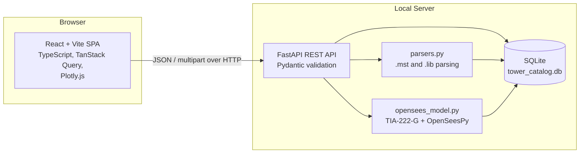
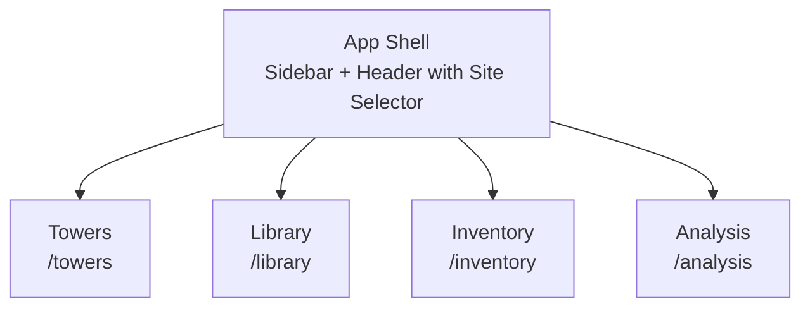
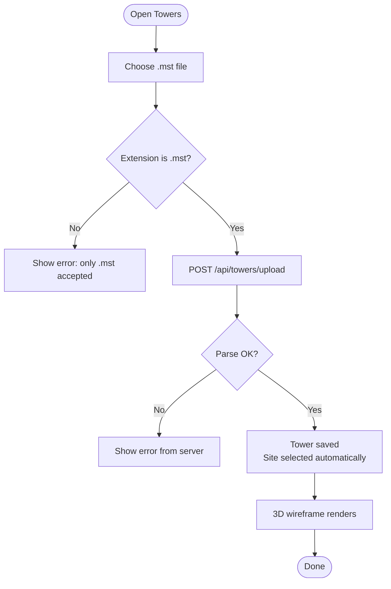
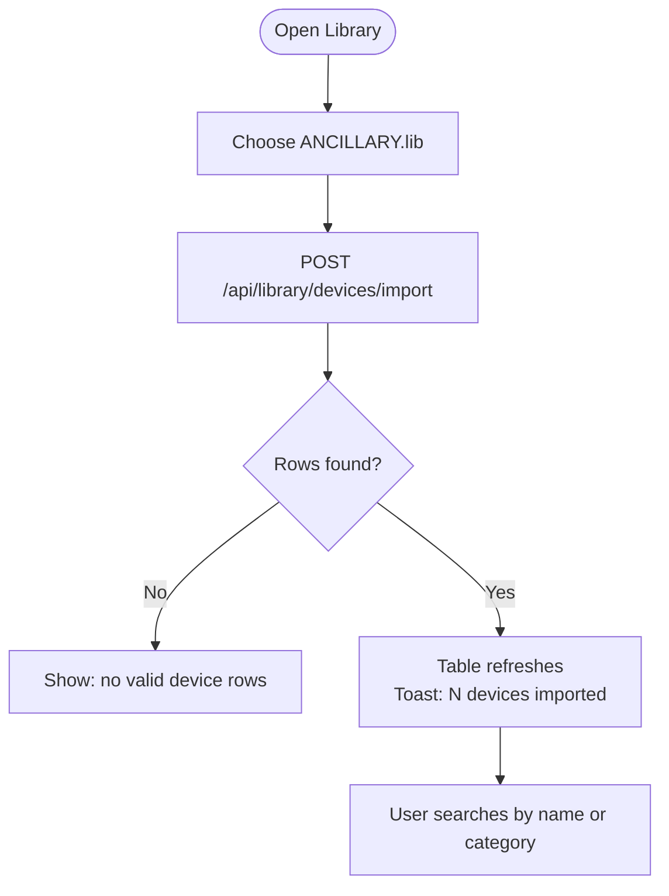
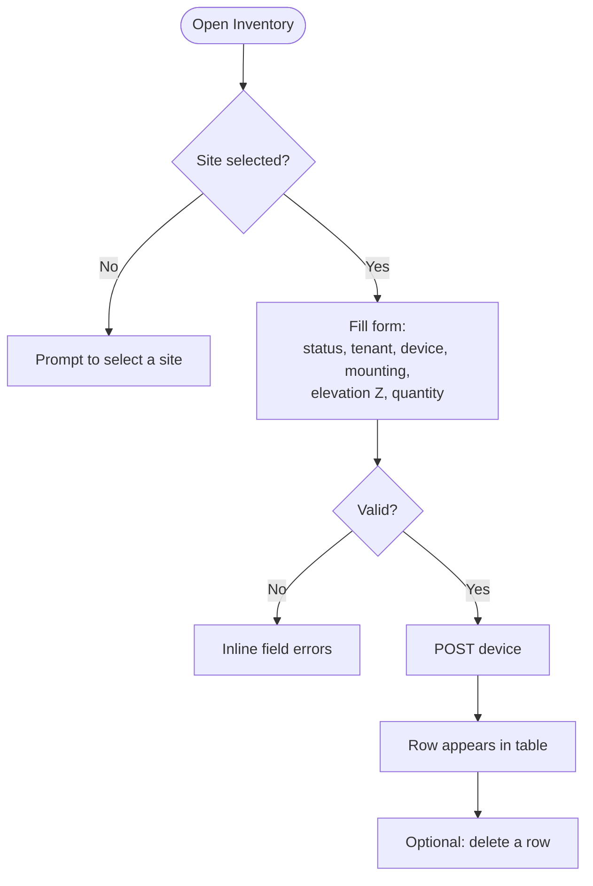
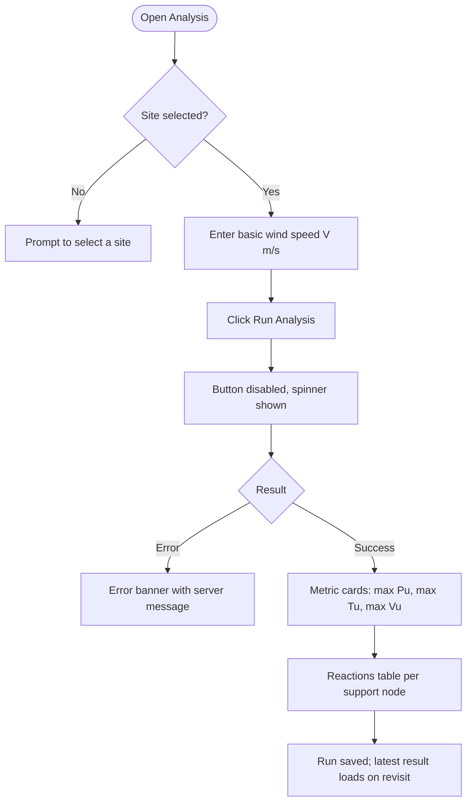
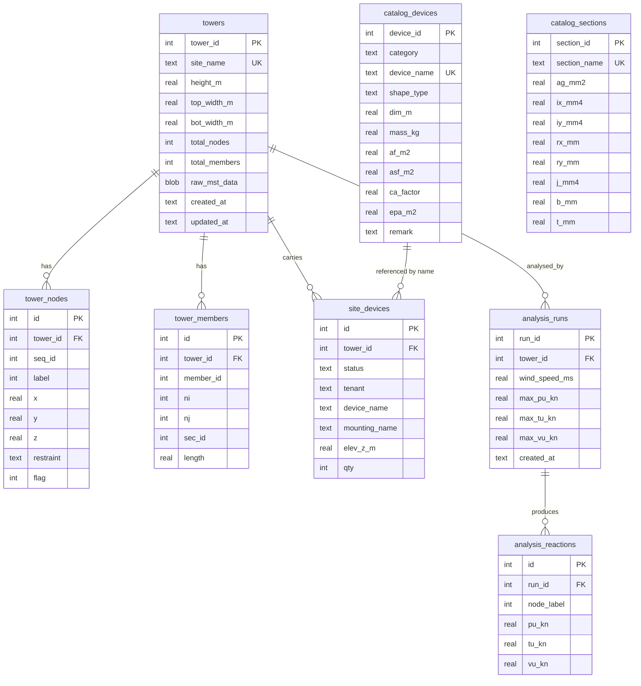

# Blueprint & Technical Guide: Structural Tower Catalog & TIA-222-G Analysis Web Application

**Version 2.0 (English edition, new frontend)**

This web application is a **Structural Tower Engineering Dashboard**: a fast, responsive, locally hosted tool for telecom tower engineering. It combines tower inventory management, parsing of Microstran (`.mst`) files, an operator device and steel-section library (`ANCILLARY.lib`, `BS 5950 .lib`), and a Finite Element Method (FEM) analysis core built on **OpenSeesPy** following **TIA-222-G**.

## Document Set

| # | Document | Purpose |
|---|----------|---------|
| 1 | [PRD](#1-prd--product-requirements-documentation) | What we build, for whom, and why |
| 2 | [TRD](#2-trd--technical-requirements-documentation) | How it is built: architecture, stack, engineering rules |
| 3 | [AFD](#3-afd--app-flow-documentation) | Screens, navigation and user flows |
| 4 | [DBD](#4-dbd--design-brief-documentation) | Visual language, layout and UI components |
| 5 | [BSD](#5-bsd--backend-schema-documentation) | Database schema and REST API contract |
| 6 | [IPD](#6-ipd--implementation-plan-documentation) | Phased plan, tasks, and definition of done |
| 7 | [Reference Implementation](#7-reference-implementation) | Working starter code for backend and frontend |

## What Changed From the Original Blueprint

| Area | Original (v1) | This version (v2) |
|------|---------------|-------------------|
| Language | Indonesian | English |
| Frontend | Streamlit (Python-rendered UI) | **React 18 + Vite + TypeScript**, TanStack Query, React Router, Plotly.js |
| Backend | Mixed into `app.py` | **FastAPI** REST service; parsers, DB and FEM stay in Python |
| Site selection | Repeated `selectbox` on every page | One global site selector in the header |
| 3D view | Hard-coded dummy points | Real nodes and members read from the parsed `.mst` |
| Tower height and widths | Hard-coded `42.0 / 1.30 / 4.00` | Computed from parsed node coordinates |
| Analysis page | Hard-coded result numbers and balloons | Real OpenSeesPy run, results persisted per run |
| Device loads | `devices_list` argument was never used | Inventory EPA and mass are applied as nodal loads |
| SQL | f-string query (injection risk) | Parameterized queries only |
| `requirements.txt` | Listed `sqlite3` (standard library, not installable) | Removed |
| Re-uploading a tower | `INSERT OR REPLACE` | Upsert that keeps the site's device inventory |
| Missing column | `mounting_name` never written | Included in inventory form and API |
| Leg interaction ratio | Hard-coded `0.54` | Marked as **Phase 2** (not faked) |

---

# 1. PRD: Product Requirements Documentation

## 1.1 Overview

**Product name:** Tower Dashboard (Structural Tower Catalog & TIA-222-G Analysis)
**Product type:** Local-first web application (single machine, no external DB server)
**Primary users:** Telecom structural engineers and tower asset administrators

## 1.2 Problem Statement

Tower structural data lives in scattered Microstran `.mst` files, text-based `.lib` libraries and spreadsheets. When an operator (for example Telkomsel, IOH, XL, Smartfren) proposes a new antenna or microwave dish, the engineer must manually:

1. Find the correct tower model file.
2. Look up antenna and mounting data (EPA, mass).
3. Update the load inventory (existing and proposed).
4. Re-run a TIA-222-G analysis and read support reactions.

This is slow, error-prone, and hard to audit.

## 1.3 Goals

| ID | Goal | Measure of success |
|----|------|--------------------|
| G1 | Centralize tower models and device libraries in one searchable catalog | Any site opens in ≤ 2 clicks |
| G2 | Remove manual parsing of `.mst` and `.lib` files | Upload to stored model in < 5 s for a 5,000-node model |
| G3 | Track existing vs. proposed equipment per site | 100% of inventory rows carry status, tenant, elevation, quantity |
| G4 | Run a repeatable TIA-222-G static P-Delta analysis from the stored model and inventory | Same inputs always return the same reactions; each run is stored |
| G5 | Provide a clear, fast UI | First meaningful paint < 2 s on a mid-range laptop |

## 1.4 Non-Goals (this release)

* Full member-by-member code checking (capacity, slenderness, connection design).
* Foundation design.
* Multi-user accounts, cloud hosting, and role permissions.
* Editing the tower geometry inside the app.
* Wind directions other than the single 45° resultant used for the screening analysis.
* Ice loading, seismic loading, and load combinations beyond 1.2D + 1.6W.

## 1.5 Personas

| Persona | Description | Main needs |
|---------|-------------|------------|
| **Structural Engineer (Rina)** | Runs analyses and writes reports | Trustworthy numbers, traceable inputs, quick re-runs |
| **Tower Asset Admin (Budi)** | Maintains site and tenant records | Fast data entry, search, clear existing vs. proposed status |
| **Reviewer (Andi)** | Checks another engineer's work | Read-only view of geometry, inventory and stored results |

## 1.6 User Stories

| ID | As a… | I want to… | So that… | Priority |
|----|-------|-----------|----------|----------|
| US-01 | Engineer | upload a `.mst` file | the tower is parsed and saved automatically | Must |
| US-02 | Engineer | see the tower in an interactive 3D wireframe | I can verify the geometry visually | Must |
| US-03 | Admin | import `ANCILLARY.lib` | the device catalog is searchable | Must |
| US-04 | Admin | add, view and delete devices per site, marked EXISTING or PROPOSED | the load inventory is accurate | Must |
| US-05 | Engineer | enter the basic wind speed and run the analysis | I get support reactions (Pu, Tu, Vu) | Must |
| US-06 | Engineer | see results from the latest and earlier runs | I can compare before and after adding equipment | Should |
| US-07 | Admin | search the device library by name or category | I find the right antenna quickly | Should |
| US-08 | Reviewer | open a site read-only | I can review without changing data | Could (Phase 2) |
| US-09 | Engineer | export results to CSV | I can paste them in a report | Could (Phase 2) |
| US-10 | Engineer | see leg interaction ratios | I can judge pass or fail | Could (Phase 2) |

## 1.7 Functional Requirements

| ID | Requirement | Story |
|----|-------------|-------|
| FR-01 | The system shall accept `.mst` uploads and extract the `DAT~` ASCII block (nodes and members). | US-01 |
| FR-02 | The system shall compute height, top width and bottom width from node coordinates. | US-01 |
| FR-03 | The system shall store parsed nodes and members and keep the original file bytes. | US-01 |
| FR-04 | Uploading a file with an existing site name shall update the tower and keep its device inventory. | US-01 |
| FR-05 | The system shall render the structure as a 3D wireframe with supports highlighted. | US-02 |
| FR-06 | The system shall import `ANCILLARY.lib`, derive category, shape, dimensions, mass, Af, Asf, Ca and EPA, and upsert by device name. | US-03 |
| FR-07 | The system shall list and search the device library. | US-07 |
| FR-08 | The system shall let the user add and delete inventory rows (status, tenant, device, mounting, elevation Z, quantity). | US-04 |
| FR-09 | The system shall run a 3D static P-Delta analysis in OpenSeesPy with TIA-222-G velocity pressure. | US-05 |
| FR-10 | The system shall apply each inventory device as wind and dead nodal loads at its elevation. | US-05 |
| FR-11 | The system shall return per-support Pu (compression), Tu (uplift) and Vu (shear), and store every run. | US-05, US-06 |
| FR-12 | The system shall show clear errors for bad files, missing data, and non-converged analyses. | All |

## 1.8 Non-Functional Requirements

| ID | Category | Requirement |
|----|----------|-------------|
| NFR-01 | Performance | `.mst` parse and save ≤ 5 s for 5,000 nodes; analysis ≤ 30 s for 2,000 members |
| NFR-02 | Reliability | A failed analysis must never corrupt stored data |
| NFR-03 | Usability | Every page has designed loading, empty and error states |
| NFR-04 | Accessibility | WCAG 2.1 AA contrast and keyboard-operable controls |
| NFR-05 | Portability | Runs on Windows, macOS and Linux with Python 3.10+ and Node 20+ |
| NFR-06 | Security | Local-only by default; parameterized SQL; upload size and type limits |
| NFR-07 | Maintainability | Parsers, FEM and API layers separately testable |

## 1.9 Assumptions

* All geometry in the `.mst` file is in **meters**, with **Z vertical**.
* Support nodes carry the restraint string `111111`.
* Operators' device codes in the inventory match `device_name` in the library.
* The screening analysis uses one wind direction (45° resultant) and constant section properties until section mapping is implemented.

## 1.10 Risks & Open Questions

| ID | Item | Impact | Mitigation |
|----|------|--------|-----------|
| R-01 | Member node references may be node **labels** rather than sequential indexes | Wrong wireframe and FEM connectivity | Verify against real files in Phase 1; parser exposes both |
| R-02 | `.mst` is partly binary; the regex parser may miss variants | Missing nodes or members | Collect sample files; add parser unit tests |
| R-03 | Constant section properties give approximate forces | Reactions not suitable for final design | Phase 2: map `sec_id` to `catalog_sections` |
| R-04 | OpenSeesPy uses global state | Concurrent runs corrupt each other | Single global lock around analysis |
| Q-01 | Which wind direction set is required for sign-off? | Scope of Phase 2 | Confirm with lead engineer |

## 1.11 Release Scope

| Release | Contents |
|---------|----------|
| **MVP (v1.0)** | FR-01 to FR-12 |
| **v1.1** | Section mapping, interaction ratio, CSV export, read-only mode |
| **v1.2** | Multi-direction wind, load combinations, PDF report |

---

# 2. TRD: Technical Requirements Documentation

## 2.1 Architecture



**Pattern:** a single-page application talks to a stateless REST API. All persistent state lives in SQLite. The FEM engine is invoked synchronously and serialized by a lock.

## 2.2 Technology Stack

| Layer | Choice | Reason |
|-------|--------|--------|
| Frontend framework | **React 18 + TypeScript** | Typed UI, large ecosystem |
| Build tool | **Vite 5** | Fast dev server and builds |
| Routing | **React Router 6** | Page-level navigation |
| Server state | **TanStack Query 5** | Caching, loading and error states, invalidation |
| 3D and charts | **Plotly.js (dist-min) via react-plotly.js** | Same visualization engine as v1, no WebGL code to maintain |
| Styling | Plain CSS with design tokens (see DBD) | No build-time dependency, easy theming |
| API | **FastAPI + Uvicorn** | Typed, validated, auto-generated docs at `/docs` |
| Validation | **Pydantic v2** | Request and response models |
| Database | **SQLite 3** (stdlib `sqlite3`) | Zero-install, file-based, fast |
| Data handling | pandas, numpy | Library parsing |
| FEM | **OpenSeesPy ≥ 3.5** | Nonlinear P-Delta 3D static analysis |
| Design standard | **TIA-222-G** | Wind load basis |

## 2.3 Repository Layout

```text
tower_dashboard/
├── backend/
│   ├── main.py              # FastAPI app and routes
│   ├── db.py                # Schema, connection helper
│   ├── parsers.py           # .mst and ANCILLARY.lib parsers
│   ├── opensees_model.py    # FEM model and TIA-222-G loads
│   ├── requirements.txt
│   └── tests/               # pytest suites
└── frontend/
    ├── package.json
    ├── vite.config.ts
    ├── index.html
    └── src/
        ├── main.tsx
        ├── App.tsx
        ├── SiteContext.tsx
        ├── api.ts
        ├── types.ts
        ├── index.css
        ├── components/TowerViewer.tsx
        └── pages/
            ├── TowersPage.tsx
            ├── LibraryPage.tsx
            ├── InventoryPage.tsx
            └── AnalysisPage.tsx
```

## 2.4 Component Responsibilities

| Component | Responsibility | Must not |
|-----------|----------------|----------|
| `parsers.py` | Turn bytes or text into plain Python structures | Touch the database |
| `db.py` | Create schema, hand out connections | Contain business rules |
| `opensees_model.py` | Build the model, apply loads, return reactions | Read files or the DB |
| `main.py` | HTTP, validation, orchestration, persistence | Contain FEM math |
| Frontend `api.ts` | Only place that calls `fetch` | Hold UI state |
| Frontend pages | Compose queries, mutations and components | Parse engineering data |

## 2.5 FEM Modeling Rules

| Item | Rule |
|------|------|
| Units | m, kN, kN/m² (E = 2.05 × 10⁸ kN/m²), mass in kg |
| Model | `ndm = 3`, `ndf = 6` |
| Nodes | Skip nodes with `flag == -1` or `abs(x) > 1e5` (helper or dummy nodes) |
| Supports | Nodes whose restraint is `111111` are fully fixed |
| Elements | `elasticBeamColumn` with `PDelta` geometric transformation |
| Transformation | `vecxz = (0,1,0)`; members parallel to the Y axis use `vecxz = (0,0,1)` |
| Section (MVP) | Constant placeholder: A = 0.00094 m², I = 4.48 × 10⁻⁸ m⁴, J = 1.0 × 10⁻⁸ m⁴ |
| Shear modulus | G = E / (2 × 1.25) |
| Analysis | `Static`, `LoadControl(1.0)`, `Newton`, one step; return code must be checked |
| Reactions | Call `ops.reactions()` then `ops.nodeReaction`; Z reaction > 0 is compression (Pu), < 0 is uplift (Tu) |

## 2.6 TIA-222-G Load Model (screening level)

Velocity pressure at height *z*:

```text
Kz = 2.01 · (max(z, 4.6) / 274.32)^(2 / 9.5)          (Exposure C, z in m)
qz = 0.613 · Kz · Kzt · Kd · V² · I / 1000              (kN/m²)
```

| Parameter | Value |
|-----------|-------|
| Kd (directionality) | 0.85 |
| Kzt (topographic) | 1.0 |
| I (importance) | 1.0 |
| Gh (gust response) | 0.85 |
| Wind load factor | 1.6 |
| Dead load factor | 1.2 |
| Wind direction | Resultant at 45° (cos = sin = 0.707) |

Load sources per analysis:

1. **Structure self-wind (placeholder):** at every free node, `1.6 · qz · Gh · 0.15 m² · 0.707` in X and Y, plus `1.2 · 0.5 kN` dead load downward. The 0.15 m² tributary area is a **placeholder** until member projected areas are computed (Phase 2).
2. **Inventory devices:** for each device, wind `= 1.6 · qz(z) · Gh · EPA · qty` and dead `= 1.2 · mass · 9.81 / 1000 · qty`, distributed equally to the free nodes at the level nearest the device elevation.

> **Engineering notice:** results are for screening and catalog management. They are not a substitute for a full code check by a licensed engineer.

## 2.7 Concurrency & Performance

* OpenSeesPy keeps global state, so every analysis runs inside a process-wide `threading.Lock`.
* FastAPI runs plain `def` routes in a thread pool, so long analyses do not block read endpoints.
* Bulk inserts use `executemany` inside one transaction.
* SQLite uses `PRAGMA foreign_keys = ON`; indexes are defined in the BSD.

## 2.8 Error Handling

| Situation | HTTP | Body `detail` |
|-----------|------|---------------|
| Wrong file extension | 400 | "Only .mst files are accepted." |
| No `DAT~` block | 422 | "ASCII DAT~ block not found in the .mst file." |
| Unknown site | 404 | "Site not found." |
| Analysis has no data | 409 | "Tower has no structural nodes." |
| Analysis not converged | 500 | "Analysis did not converge." |
| Validation failure | 422 | Pydantic error list |

## 2.9 Security

* Bind to `127.0.0.1` by default.
* All SQL is parameterized.
* Upload limit: 50 MB for `.mst`, 5 MB for `.lib`.
* CORS allows only the Vite dev origin in development.
* No secrets are stored; there is no authentication in the MVP. If exposed beyond localhost, add a reverse proxy with authentication first.

## 2.10 Testing Strategy

| Level | Tool | Scope |
|-------|------|-------|
| Unit | pytest | Parsers (sample `.mst` and `.lib` fixtures), `velocity_pressure`, geometry summary |
| Integration | pytest + FastAPI `TestClient` | Upload, inventory CRUD, analysis on a small 4-leg test tower |
| Component | Vitest + Testing Library | Forms, tables, empty and error states |
| End-to-end | Playwright | Upload → inventory → analysis happy path |

## 2.11 Deployment

* **Development:** `uvicorn main:app --reload` and `npm run dev` (Vite proxies `/api` to port 8000).
* **Production (local):** `npm run build`, then serve `frontend/dist` through FastAPI `StaticFiles` or any static server.
* Back up by copying `tower_catalog.db`.

---

# 3. AFD: App Flow Documentation

## 3.1 Information Architecture



| Route | Screen | Needs a selected site? |
|-------|--------|------------------------|
| `/towers` | Tower catalog, upload, 3D viewer | No |
| `/library` | Device library import and search | No |
| `/inventory` | Existing and proposed devices for the active site | Yes |
| `/analysis` | Run analysis and view results for the active site | Yes |

The **site selector** lives in the header and applies to every page. On first load it selects the first available site automatically.

## 3.2 Screen Inventory

| Screen | Key elements | States |
|--------|--------------|--------|
| Towers | Upload area, tower table (name, height, nodes, members, delete), 3D viewer | Empty: "No towers yet. Upload a .mst file." · Loading skeleton · Upload error banner |
| Library | Upload `ANCILLARY.lib`, search field, device table | Empty: "Library is empty. Import ANCILLARY.lib." · Loading · Import error |
| Inventory | Add-device form, inventory table with status badges | No site: "Select or upload a tower first." · Empty table · Validation errors |
| Analysis | Wind speed field, Run button, metric cards, reactions table | No site · Running (spinner) · Success · Error banner |

## 3.3 Flow A: Upload a Tower



## 3.4 Flow B: Import the Device Library



## 3.5 Flow C: Manage Site Inventory



Device name input offers autocomplete from the library. A name not found in the library is accepted but flagged with a warning badge ("not in library, EPA = 0"), because its load cannot be computed.

## 3.6 Flow D: Run the Analysis



## 3.7 Cross-Cutting Behaviors

| Behavior | Rule |
|----------|------|
| Loading | Skeletons for tables; spinner inside the Run button |
| Errors | Inline banner at the top of the page content with the server `detail` text |
| Success | Short toast, auto-dismiss after 4 s |
| Destructive actions | Deleting a tower asks for confirmation because it removes its inventory and runs |
| Persistence | Active site is remembered in `localStorage` |
| Keyboard | Tab order follows visual order; Enter submits forms |

---

# 4. DBD: Design Brief Documentation

## 4.1 Design Intent

A calm, precise **engineering workbench**. Data is dense but never cramped; the interface stays out of the way and highlights numbers that matter (loads, reactions, status).

**Keywords:** precise, technical, trustworthy, quiet.

## 4.2 Layout

```text
┌───────────────┬──────────────────────────────────────────────┐
│  Sidebar      │  Header:  Page title            [Site ▼]     │
│  (240 px)     ├──────────────────────────────────────────────┤
│               │                                              │
│  ▣ Towers     │   Page content (max-width 1280 px)           │
│  ▣ Library    │   Cards on a 12-column grid, 24 px gap       │
│  ▣ Inventory  │                                              │
│  ▣ Analysis   │                                              │
└───────────────┴──────────────────────────────────────────────┘
```

| Breakpoint | Behavior |
|------------|----------|
| ≥ 1024 px | Fixed sidebar, two-column content where useful |
| 640–1023 px | Sidebar collapses to an icon rail; single column |
| < 640 px | Sidebar becomes a top bar menu; tables scroll horizontally inside their own container |

## 4.3 Design Tokens

**Color**

| Token | Light | Dark | Use |
|-------|-------|------|-----|
| `--bg` | `#F6F7F9` | `#0F141B` | Page background |
| `--surface` | `#FFFFFF` | `#171E27` | Cards, tables |
| `--border` | `#E1E5EB` | `#2A3441` | Dividers |
| `--text` | `#1B2430` | `#E8ECF1` | Body text |
| `--muted` | `#5B6778` | `#9AA7B8` | Secondary text |
| `--primary` | `#1F5FBF` | `#5B9BFF` | Actions, active nav, structure lines |
| `--existing` | `#1E8E5A` | `#4CC38A` | EXISTING badge |
| `--proposed` | `#B76E00` | `#F2B34A` | PROPOSED badge |
| `--danger` | `#C73A3A` | `#FF7B7B` | Errors, delete, uplift |

**Typography**

| Role | Font | Size / weight |
|------|------|---------------|
| UI text | Inter, system-ui, sans-serif | 14 px / 400 |
| Page title | Inter | 22 px / 600 |
| Card title | Inter | 16 px / 600 |
| Numbers and codes | JetBrains Mono, ui-monospace | 13 px / 500, tabular figures |

**Spacing and shape:** 4 px base unit (4, 8, 12, 16, 24, 32). Radius 8 px for cards, 6 px for inputs. Single 1 px border, no heavy shadows.

## 4.4 Components

| Component | Spec |
|-----------|------|
| **Button, primary** | Filled `--primary`, white text, 36 px high; disabled at 50% opacity with spinner while loading |
| **Button, quiet** | Transparent, border `--border`; danger variant uses `--danger` text |
| **Input / Select** | 36 px high, 1 px border, focus ring 2 px `--primary` |
| **Card** | `--surface`, 1 px border, 16 px padding, optional title row |
| **Table** | Sticky header, 40 px rows, right-aligned numerics in mono font, zebra off, hover row tint |
| **Badge** | Pill, 12 px text; EXISTING = green tint, PROPOSED = amber tint |
| **Metric card** | Large mono number (28 px), label above, unit beside |
| **Banner** | Full-width inside content; red tint for errors, blue tint for info |
| **Empty state** | Centered icon, one sentence of explanation, one primary action |
| **Skeleton** | Gray pulsing bars matching table row height |

## 4.5 3D Viewer Spec

* Members drawn as thin lines in `--primary`; supports as larger markers in `--danger`.
* Equal aspect ratio on all axes so the tower is not distorted.
* Orbit, pan and zoom by mouse or touch; Plotly mode bar limited to *reset camera* and *download PNG*.
* Height 480 px on desktop, 320 px on mobile; transparent background so it follows light and dark themes.
* Provide a text summary beside it (height, widths, node and member counts) so the information is not only visual.

## 4.6 Key Screen Wireframes

**Towers**

```text
┌ Upload ──────────────────────┐ ┌ 3D Viewer: SITE-001 ───────────┐
│  Drop .mst here or [Browse]  │ │                                │
└──────────────────────────────┘ │          (wireframe)           │
┌ Towers ──────────────────────┐ │                                │
│ Site       H(m) Nodes Members│ └────────────────────────────────┘
│ SITE-001   42.0  812   1,540 │ Height 42.0 m · Top 1.30 m · Base 4.00 m
└──────────────────────────────┘
```

**Analysis**

```text
┌ Parameters ─────────────────────────────────────────────┐
│ Basic wind speed V [ 33.33 ] m/s          [ Run analysis ]│
└──────────────────────────────────────────────────────────┘
┌ Max Pu ────┐ ┌ Max Tu ────┐ ┌ Max Vu ────┐ ┌ Run info ──┐
│ 1,049.2 kN │ │  915.6 kN  │ │   87.4 kN  │ │ #12 · now  │
└────────────┘ └────────────┘ └────────────┘ └────────────┘
┌ Support reactions ──────────────────────────────────────┐
│ Node   Pu (kN)   Tu (kN)   Vu (kN)                       │
└──────────────────────────────────────────────────────────┘
```

## 4.7 Accessibility

* Text contrast ≥ 4.5:1 in both themes; do not rely on color alone (badges also carry text).
* All controls reachable by keyboard; visible focus ring.
* Form inputs have visible labels, not placeholders alone.
* Respect `prefers-color-scheme` and `prefers-reduced-motion`.
* Error banners use `role="alert"`; loading regions use `aria-busy`.

## 4.8 Content & Tone

* Short, direct, active voice: "Upload a .mst file", not "Please kindly upload…".
* Units always shown next to values (m, kN, m/s).
* Error messages say what went wrong and what to do next.

---

# 5. BSD: Backend Schema Documentation

## 5.1 Entity Relationship Diagram



## 5.2 DDL (SQLite)

```sql
PRAGMA foreign_keys = ON;

CREATE TABLE IF NOT EXISTS catalog_devices (
    device_id   INTEGER PRIMARY KEY AUTOINCREMENT,
    category    TEXT,
    device_name TEXT NOT NULL UNIQUE,
    shape_type  TEXT,
    dim_m       REAL,
    mass_kg     REAL,
    af_m2       REAL,
    asf_m2      REAL,
    ca_factor   REAL,
    epa_m2      REAL,
    remark      TEXT
);

CREATE TABLE IF NOT EXISTS catalog_sections (
    section_id   INTEGER PRIMARY KEY AUTOINCREMENT,
    section_name TEXT NOT NULL UNIQUE,
    ag_mm2 REAL, ix_mm4 REAL, iy_mm4 REAL,
    rx_mm  REAL, ry_mm  REAL, j_mm4 REAL,
    b_mm   REAL, t_mm   REAL
);

CREATE TABLE IF NOT EXISTS towers (
    tower_id      INTEGER PRIMARY KEY AUTOINCREMENT,
    site_name     TEXT NOT NULL UNIQUE,
    height_m      REAL,
    top_width_m   REAL,
    bot_width_m   REAL,
    total_nodes   INTEGER,
    total_members INTEGER,
    raw_mst_data  BLOB,
    created_at    TEXT DEFAULT CURRENT_TIMESTAMP,
    updated_at    TEXT DEFAULT CURRENT_TIMESTAMP
);

CREATE TABLE IF NOT EXISTS tower_nodes (
    id        INTEGER PRIMARY KEY AUTOINCREMENT,
    tower_id  INTEGER NOT NULL REFERENCES towers(tower_id) ON DELETE CASCADE,
    seq_id    INTEGER NOT NULL,
    label     INTEGER,
    x REAL, y REAL, z REAL,
    restraint TEXT,
    flag      INTEGER
);
CREATE INDEX IF NOT EXISTS idx_nodes_tower ON tower_nodes(tower_id);

CREATE TABLE IF NOT EXISTS tower_members (
    id        INTEGER PRIMARY KEY AUTOINCREMENT,
    tower_id  INTEGER NOT NULL REFERENCES towers(tower_id) ON DELETE CASCADE,
    member_id INTEGER NOT NULL,
    ni INTEGER NOT NULL,
    nj INTEGER NOT NULL,
    sec_id INTEGER,
    length REAL
);
CREATE INDEX IF NOT EXISTS idx_members_tower ON tower_members(tower_id);

CREATE TABLE IF NOT EXISTS site_devices (
    id            INTEGER PRIMARY KEY AUTOINCREMENT,
    tower_id      INTEGER NOT NULL REFERENCES towers(tower_id) ON DELETE CASCADE,
    status        TEXT NOT NULL CHECK (status IN ('EXISTING','PROPOSED')),
    tenant        TEXT NOT NULL,
    device_name   TEXT NOT NULL,
    mounting_name TEXT,
    elev_z_m      REAL NOT NULL,
    qty           INTEGER NOT NULL CHECK (qty >= 1)
);
CREATE INDEX IF NOT EXISTS idx_site_devices_tower ON site_devices(tower_id);

CREATE TABLE IF NOT EXISTS analysis_runs (
    run_id        INTEGER PRIMARY KEY AUTOINCREMENT,
    tower_id      INTEGER NOT NULL REFERENCES towers(tower_id) ON DELETE CASCADE,
    wind_speed_ms REAL NOT NULL,
    max_pu_kn     REAL,
    max_tu_kn     REAL,
    max_vu_kn     REAL,
    created_at    TEXT DEFAULT CURRENT_TIMESTAMP
);

CREATE TABLE IF NOT EXISTS analysis_reactions (
    id         INTEGER PRIMARY KEY AUTOINCREMENT,
    run_id     INTEGER NOT NULL REFERENCES analysis_runs(run_id) ON DELETE CASCADE,
    node_label INTEGER,
    pu_kn REAL, tu_kn REAL, vu_kn REAL
);
CREATE INDEX IF NOT EXISTS idx_reactions_run ON analysis_reactions(run_id);
```

## 5.3 Data Rules

| Rule | Detail |
|------|--------|
| Site identity | `site_name` is the uppercased `.mst` file name without extension |
| Re-upload | Updates the `towers` row, replaces its nodes and members, keeps `site_devices` and old runs |
| Device link | `site_devices.device_name` is matched to `catalog_devices.device_name` at analysis time (soft link, so inventory can exist before the library is imported) |
| Deleting a tower | Cascades to nodes, members, devices, runs and reactions |
| Status | Only `EXISTING` or `PROPOSED` |
| Time | UTC, ISO-8601 text |

## 5.4 REST API Contract

Base path: `/api`. Content type is JSON except for uploads (`multipart/form-data`).

| Method | Path | Description |
|--------|------|-------------|
| GET | `/health` | Liveness check |
| GET | `/towers` | List towers |
| POST | `/towers/upload` | Upload and parse `.mst` (field `file`) |
| GET | `/towers/{site}` | Tower details |
| GET | `/towers/{site}/geometry` | Nodes and line segments for the viewer |
| DELETE | `/towers/{site}` | Delete tower and all related data |
| POST | `/library/devices/import` | Import `ANCILLARY.lib` (field `file`) |
| GET | `/library/devices?q=` | List or search devices (max 500 rows) |
| GET | `/sites/{site}/devices` | List inventory |
| POST | `/sites/{site}/devices` | Add an inventory row |
| DELETE | `/sites/{site}/devices/{id}` | Delete an inventory row |
| POST | `/sites/{site}/analysis` | Run analysis |
| GET | `/sites/{site}/analysis/latest` | Latest stored run with reactions |

**Tower**

```json
{
  "site_name": "SITE-001",
  "height_m": 42.0,
  "top_width_m": 1.3,
  "bot_width_m": 4.0,
  "total_nodes": 812,
  "total_members": 1540
}
```

**Geometry**

```json
{
  "nodes": [{ "id": 1, "x": 2.0, "y": 2.0, "z": 0.0, "support": true }],
  "segments": [[2.0, 2.0, 0.0, 1.9, 1.9, 3.0]]
}
```

**Add inventory row, request**

```json
{
  "status": "PROPOSED",
  "tenant": "TELKOMSEL",
  "device_name": "SEC-2.76",
  "mounting_name": "SECTOR-FRAME-A",
  "elev_z_m": 38.0,
  "qty": 3
}
```

**Run analysis, request and response**

```json
{ "wind_speed_ms": 33.33 }
```

```json
{
  "run_id": 12,
  "site_name": "SITE-001",
  "wind_speed_ms": 33.33,
  "created_at": "2026-10-28 09:14:03",
  "max_pu_kn": 1049.2,
  "max_tu_kn": 915.6,
  "max_vu_kn": 87.4,
  "reactions": [
    { "node_label": 1, "pu_kn": 1049.2, "tu_kn": 0.0, "vu_kn": 80.1 }
  ],
  "warnings": ["Device 'ABC-1' not found in library; EPA treated as 0."]
}
```

**Error format**

```json
{ "detail": "Tower has no structural nodes." }
```

## 5.5 Migration From v1 Database

v1 stored `site_devices.site_name` as text. To migrate: create the new tables, insert each v1 tower and look up its `tower_id`, then copy devices with `INSERT … SELECT` joining on `site_name`. Since `raw_mst_data` was usually empty in v1, ask users to re-upload `.mst` files to populate nodes and members.

---

# 6. IPD: Implementation Plan Documentation

## 6.1 Phases Overview

| Phase | Name | Duration | Outcome |
|-------|------|----------|---------|
| 0 | Setup | 1 day | Repo, tooling, CI skeleton |
| 1 | Backend core | 4 days | DB, parsers, upload and geometry endpoints with tests |
| 2 | Frontend shell + Towers | 3 days | App shell, site selector, Towers page with 3D viewer |
| 3 | Library + Inventory | 3 days | Library import and search, inventory CRUD |
| 4 | FEM + Analysis | 4 days | Device loads, analysis endpoint, Analysis page, run persistence |
| 5 | Hardening | 3 days | Error states, accessibility pass, e2e tests, docs |
| 6 | v1.1 | 5 days | Section mapping, interaction ratio, CSV export, read-only mode |

Estimates assume one developer; total MVP ≈ 18 working days.

## 6.2 Task Breakdown

**Phase 0: Setup**

- [ ] Create repo with `backend/` and `frontend/`
- [ ] Python venv, `requirements.txt`, pytest config
- [ ] `npm create vite@latest` (React + TS), install dependencies
- [ ] ESLint, Prettier, Ruff
- [ ] Vite proxy for `/api`

**Phase 1: Backend core**

- [ ] `db.py` schema from BSD, `init_db()` on startup
- [ ] `parsers.py`: `.mst` parser, geometry summary, `ANCILLARY.lib` parser
- [ ] Collect at least 3 real `.mst` samples; resolve open risk R-01 (labels vs sequence)
- [ ] Routes: health, towers list, upload, details, geometry, delete
- [ ] Pytest fixtures and tests for parsers and routes

**Phase 2: Frontend shell + Towers**

- [ ] Design tokens in `index.css` (light and dark)
- [ ] `App.tsx`: sidebar, header, site selector, routes
- [ ] `api.ts` and `types.ts`
- [ ] `TowersPage`: upload, table, delete with confirmation
- [ ] `TowerViewer` with equal axis scaling and supports

**Phase 3: Library + Inventory**

- [ ] Library import and search endpoints
- [ ] `LibraryPage`
- [ ] Inventory endpoints with Pydantic validation
- [ ] `InventoryPage` with form, autocomplete and "not in library" warning

**Phase 4: FEM + Analysis**

- [ ] `opensees_model.py` with velocity pressure, device loads, transformation choice
- [ ] Analysis route with global lock and run persistence
- [ ] Integration test on a 4-leg sample tower with a hand-checkable result
- [ ] `AnalysisPage` with metrics and reactions table
- [ ] Latest-run endpoint and load-on-open behavior

**Phase 5: Hardening**

- [ ] Loading, empty and error states for every page
- [ ] Keyboard and screen-reader pass (DBD 4.7)
- [ ] Playwright happy path test
- [ ] README with install and run steps

## 6.3 Dependencies & Critical Path

```text
DB schema → Parsers → Upload API → Towers page ─┐
                         │                      ├→ Analysis page
Library import → Inventory API → Inventory page ┘
                         │
                         └→ FEM module → Analysis API
```

## 6.4 Definition of Done

A task is done when:

1. Code is merged with passing lint and tests.
2. Behavior matches the PRD requirement and AFD flow.
3. UI matches DBD tokens and covers loading, empty and error states.
4. API matches the BSD contract; schema changes are reflected in the BSD.
5. No hard-coded demo values remain in user-visible output.

## 6.5 Release Checklist (MVP)

- [ ] Upload, view, delete a tower with a real `.mst`
- [ ] Re-upload keeps the inventory
- [ ] Library import of a real `ANCILLARY.lib`
- [ ] Inventory add and delete for existing and proposed devices
- [ ] Analysis result reproducible between two runs with the same inputs
- [ ] Adding a proposed device changes reactions in the expected direction
- [ ] Hand-check of one reaction against a simple statics calculation
- [ ] Clean install tested on a second machine

## 6.6 Risk Plan

| Risk | Trigger | Response |
|------|---------|----------|
| Parser cannot read some `.mst` variants | Sample file fails | Add pattern, keep failing file as test fixture |
| Analysis too slow | > 30 s on target model | Reduce nodes in viewer only; profile FEM; consider `UmfPack` solver |
| Results questioned by reviewers | Mismatch vs. Microstran | Compare on 2 sites; document differences; prioritize section mapping |
| Scope creep to full code checking | Requests for member checks | Defer to v1.1+ with its own PRD |

---
# 7. Reference Implementation

Starter code that follows the six documents above. Create the files exactly as shown under the layout in TRD section 2.3.

## 7.1 Backend

### `backend/requirements.txt`

```text
fastapi>=0.110.0
uvicorn[standard]>=0.29.0
python-multipart>=0.0.9
pandas>=2.0.0
numpy>=1.24.0
openseespy>=3.5.0.1
pytest>=8.0.0
httpx>=0.27.0
```

> `sqlite3` is part of the Python standard library and must not be listed.

### `backend/db.py`

```python
import sqlite3
from contextlib import contextmanager

DB_PATH = "tower_catalog.db"

SCHEMA = """
CREATE TABLE IF NOT EXISTS catalog_devices (
    device_id   INTEGER PRIMARY KEY AUTOINCREMENT,
    category    TEXT,
    device_name TEXT NOT NULL UNIQUE,
    shape_type  TEXT,
    dim_m       REAL,
    mass_kg     REAL,
    af_m2       REAL,
    asf_m2      REAL,
    ca_factor   REAL,
    epa_m2      REAL,
    remark      TEXT
);

CREATE TABLE IF NOT EXISTS catalog_sections (
    section_id   INTEGER PRIMARY KEY AUTOINCREMENT,
    section_name TEXT NOT NULL UNIQUE,
    ag_mm2 REAL, ix_mm4 REAL, iy_mm4 REAL,
    rx_mm  REAL, ry_mm  REAL, j_mm4 REAL,
    b_mm   REAL, t_mm   REAL
);

CREATE TABLE IF NOT EXISTS towers (
    tower_id      INTEGER PRIMARY KEY AUTOINCREMENT,
    site_name     TEXT NOT NULL UNIQUE,
    height_m      REAL,
    top_width_m   REAL,
    bot_width_m   REAL,
    total_nodes   INTEGER,
    total_members INTEGER,
    raw_mst_data  BLOB,
    created_at    TEXT DEFAULT CURRENT_TIMESTAMP,
    updated_at    TEXT DEFAULT CURRENT_TIMESTAMP
);

CREATE TABLE IF NOT EXISTS tower_nodes (
    id        INTEGER PRIMARY KEY AUTOINCREMENT,
    tower_id  INTEGER NOT NULL REFERENCES towers(tower_id) ON DELETE CASCADE,
    seq_id    INTEGER NOT NULL,
    label     INTEGER,
    x REAL, y REAL, z REAL,
    restraint TEXT,
    flag      INTEGER
);
CREATE INDEX IF NOT EXISTS idx_nodes_tower ON tower_nodes(tower_id);

CREATE TABLE IF NOT EXISTS tower_members (
    id        INTEGER PRIMARY KEY AUTOINCREMENT,
    tower_id  INTEGER NOT NULL REFERENCES towers(tower_id) ON DELETE CASCADE,
    member_id INTEGER NOT NULL,
    ni INTEGER NOT NULL,
    nj INTEGER NOT NULL,
    sec_id INTEGER,
    length REAL
);
CREATE INDEX IF NOT EXISTS idx_members_tower ON tower_members(tower_id);

CREATE TABLE IF NOT EXISTS site_devices (
    id            INTEGER PRIMARY KEY AUTOINCREMENT,
    tower_id      INTEGER NOT NULL REFERENCES towers(tower_id) ON DELETE CASCADE,
    status        TEXT NOT NULL CHECK (status IN ('EXISTING','PROPOSED')),
    tenant        TEXT NOT NULL,
    device_name   TEXT NOT NULL,
    mounting_name TEXT,
    elev_z_m      REAL NOT NULL,
    qty           INTEGER NOT NULL CHECK (qty >= 1)
);
CREATE INDEX IF NOT EXISTS idx_site_devices_tower ON site_devices(tower_id);

CREATE TABLE IF NOT EXISTS analysis_runs (
    run_id        INTEGER PRIMARY KEY AUTOINCREMENT,
    tower_id      INTEGER NOT NULL REFERENCES towers(tower_id) ON DELETE CASCADE,
    wind_speed_ms REAL NOT NULL,
    max_pu_kn     REAL,
    max_tu_kn     REAL,
    max_vu_kn     REAL,
    created_at    TEXT DEFAULT CURRENT_TIMESTAMP
);

CREATE TABLE IF NOT EXISTS analysis_reactions (
    id         INTEGER PRIMARY KEY AUTOINCREMENT,
    run_id     INTEGER NOT NULL REFERENCES analysis_runs(run_id) ON DELETE CASCADE,
    node_label INTEGER,
    pu_kn REAL, tu_kn REAL, vu_kn REAL
);
CREATE INDEX IF NOT EXISTS idx_reactions_run ON analysis_reactions(run_id);
"""


def init_db() -> None:
    conn = sqlite3.connect(DB_PATH)
    try:
        conn.executescript(SCHEMA)
        conn.commit()
    finally:
        conn.close()


@contextmanager
def connect():
    """One connection per request; commits on success, rolls back on error."""
    conn = sqlite3.connect(DB_PATH)
    conn.row_factory = sqlite3.Row
    conn.execute("PRAGMA foreign_keys = ON")
    try:
        yield conn
        conn.commit()
    except Exception:
        conn.rollback()
        raise
    finally:
        conn.close()


if __name__ == "__main__":
    init_db()
    print("SQLite database initialized.")
```

### `backend/parsers.py`

```python
import re
import pandas as pd

NUM = r"[+-]?\d+\.\d+E[+-]\d+"
NODE_PATTERN = re.compile(
    rf"^\s*(\d+)\s+({NUM})\s+({NUM})\s+({NUM})\s+(\d{{6}})\s+([+-]?\d+)"
)
MEMBER_PATTERN = re.compile(
    r"^\s*(\d+)\s+(\d+)\s+(\d+)\s+(\d+)\s+(\d+)\s+(\d+)\s+(\d+)\s+(\d+\.\d+)"
)


def is_structural(node: dict) -> bool:
    """Skip helper or dummy nodes."""
    return node["flag"] != -1 and abs(node["x"]) <= 1e5


def parse_mst_content(raw_bytes: bytes):
    """Extract the ASCII DAT~ block of a .mst file: node coordinates and members."""
    content = raw_bytes.decode("latin1")
    start_idx = content.find("DAT~")
    if start_idx == -1:
        raise ValueError("ASCII DAT~ block not found in the .mst file.")
    end_idx = content.find("AL4~", start_idx)
    dat_block = content[start_idx:end_idx] if end_idx != -1 else content[start_idx:]
    lines = [ln.strip() for ln in dat_block.splitlines() if ln.strip()]

    nodes: dict[int, dict] = {}
    members: list[dict] = []
    seq = 1
    for line in lines:
        m_node = NODE_PATTERN.match(line)
        if m_node:
            nodes[seq] = {
                "label": int(m_node.group(1)),
                "x": float(m_node.group(2)),
                "y": float(m_node.group(3)),
                "z": float(m_node.group(4)),
                "restraint": m_node.group(5),
                "flag": int(m_node.group(6)),
            }
            seq += 1
            continue

        m_memb = MEMBER_PATTERN.match(line)
        if m_memb:
            members.append(
                {
                    "id": int(m_memb.group(1)),
                    "ni": int(m_memb.group(2)),
                    "nj": int(m_memb.group(3)),
                    "sec_id": int(m_memb.group(5)),
                    "length": float(m_memb.group(8)),
                }
            )
    return nodes, members


def summarize_geometry(nodes: dict[int, dict]) -> dict:
    """Height and top/bottom widths computed from the structural nodes."""
    pts = [n for n in nodes.values() if is_structural(n)]
    if not pts:
        return {"height_m": 0.0, "top_width_m": 0.0, "bot_width_m": 0.0}
    z_min = min(n["z"] for n in pts)
    z_max = max(n["z"] for n in pts)

    def width_at(z: float) -> float:
        level = [n for n in pts if abs(n["z"] - z) < 0.01]
        xs = [n["x"] for n in level]
        return round(max(xs) - min(xs), 3) if xs else 0.0

    return {
        "height_m": round(z_max - z_min, 3),
        "top_width_m": width_at(z_max),
        "bot_width_m": width_at(z_min),
    }


CA_MAP = {"BOX": 1.4, "CYL": 1.2, "SH1": 0.7, "UNITY": 1.0, "GRID": 0.6}
CATEGORY_KEYWORDS = ["SMARTFREN", "TELKOMSEL", "H3I", "INDOSAT", "IOH", "XL", "MW", "MOUNTING"]


def parse_ancillary_lib(lib_text: str) -> pd.DataFrame:
    """Extract the antenna and device catalog from ANCILLARY.lib."""
    devices = []
    current_category = "GENERAL"
    anc_section = lib_text.split("COEFFICIENTS")[0]

    for raw_line in anc_section.splitlines():
        line = raw_line.strip()
        if not line:
            continue
        if line.startswith("$"):
            clean = re.sub(r"[\$\=\-]+", " ", line).strip()
            if any(k in clean.upper() for k in CATEGORY_KEYWORDS):
                current_category = clean
            continue

        parts = line.split("$", 1)
        tokens = parts[0].strip().split()
        remark = parts[1].strip() if len(parts) > 1 else ""
        if len(tokens) < 6:
            continue
        try:
            dev_type = tokens[1].upper()
            af_m2 = float(tokens[4])
            ca_factor = CA_MAP.get(dev_type, 1.2)
            devices.append(
                {
                    "category": current_category,
                    "device_name": tokens[0],
                    "shape_type": dev_type,
                    "dim_m": float(tokens[2]),
                    "mass_kg": float(tokens[3]),
                    "af_m2": af_m2,
                    "asf_m2": float(tokens[5]),
                    "ca_factor": ca_factor,
                    "epa_m2": round(af_m2 * ca_factor, 4),
                    "remark": remark,
                }
            )
        except ValueError:
            continue
    return pd.DataFrame(devices)
```

### `backend/opensees_model.py`

```python
import math
import openseespy.opensees as ops

from parsers import is_structural

E_KN_M2 = 2.05e8          # Young's modulus, kN/m2
G_KN_M2 = E_KN_M2 / (2.0 * 1.25)
Z_G = 274.32              # gradient height, m (Exposure C)
ALPHA = 9.5
KD, KZT, I_FACTOR, GH = 0.85, 1.0, 1.0, 0.85
WIND_FACTOR, DEAD_FACTOR = 1.6, 1.2
TRIBUTARY_AREA_M2 = 0.15  # PLACEHOLDER until member projected areas are computed
A_SEC, J_SEC, I_SEC = 0.00094, 1.0e-8, 4.48e-8  # PLACEHOLDER section properties
DIAG = 0.707              # 45 degree wind resultant


def velocity_pressure(z: float, v_ms: float) -> float:
    """TIA-222-G velocity pressure qz in kN/m2."""
    z_eff = max(z, 4.6)
    kz = 2.01 * (z_eff / Z_G) ** (2.0 / ALPHA)
    return 0.613 * kz * KZT * KD * (v_ms ** 2) * I_FACTOR / 1000.0


def _pick_transf(a: dict, b: dict) -> int:
    """Transformation 2 for members parallel to the Y axis, otherwise 1."""
    dx, dy, dz = b["x"] - a["x"], b["y"] - a["y"], b["z"] - a["z"]
    length = math.sqrt(dx * dx + dy * dy + dz * dz)
    return 2 if length > 0 and abs(dy) / length > 0.99 else 1


def run_tia222g_analysis(nodes, members, devices_list, v_basic_ms=33.33):
    """
    nodes:        {seq_id: {label, x, y, z, restraint, flag}}
    members:      [{id, ni, nj, sec_id, length}]
    devices_list: [{elev_z_m, qty, epa_m2, mass_kg}]
    Returns: list of {node_label, pu_kn, tu_kn, vu_kn}
    """
    ops.wipe()
    try:
        ops.model("basic", "-ndm", 3, "-ndf", 6)

        structural = {sid: nd for sid, nd in nodes.items() if is_structural(nd)}
        if not structural:
            raise ValueError("Tower has no structural nodes.")

        supports = []
        for sid, nd in structural.items():
            ops.node(sid, nd["x"], nd["y"], nd["z"])
            if nd["restraint"] == "111111":
                ops.fix(sid, 1, 1, 1, 1, 1, 1)
                supports.append(sid)
        if not supports:
            raise ValueError("Tower has no support nodes (restraint 111111).")

        ops.geomTransf("PDelta", 1, 0.0, 1.0, 0.0)
        ops.geomTransf("PDelta", 2, 0.0, 0.0, 1.0)

        element_count = 0
        for mb in members:
            ni, nj = mb["ni"], mb["nj"]
            if ni == nj or ni not in structural or nj not in structural:
                continue
            ops.element(
                "elasticBeamColumn", mb["id"], ni, nj,
                A_SEC, E_KN_M2, G_KN_M2, J_SEC, I_SEC, I_SEC,
                _pick_transf(structural[ni], structural[nj]),
            )
            element_count += 1
        if element_count == 0:
            raise ValueError("No valid members connect structural nodes.")

        # ---- Loads -------------------------------------------------------
        free = {sid: nd for sid, nd in structural.items() if sid not in supports}
        if not free:
            raise ValueError("Model has no free nodes to load.")
        loads = {sid: [0.0, 0.0, 0.0] for sid in free}

        # 1) Structure self-wind and dead load (placeholder)
        for sid, nd in free.items():
            qz = velocity_pressure(nd["z"], v_basic_ms)
            w = WIND_FACTOR * qz * GH * TRIBUTARY_AREA_M2 * DIAG
            loads[sid][0] += w
            loads[sid][1] += w
            loads[sid][2] += -DEAD_FACTOR * 0.5

        # 2) Inventory devices at their elevations
        z_levels = sorted({round(nd["z"], 3) for nd in free.values()})
        for dev in devices_list:
            level = min(z_levels, key=lambda z: abs(z - dev["elev_z_m"]))
            targets = [sid for sid, nd in free.items() if abs(nd["z"] - level) < 0.01]
            qty = dev["qty"]
            epa = dev.get("epa_m2") or 0.0
            mass = dev.get("mass_kg") or 0.0
            wind = WIND_FACTOR * velocity_pressure(level, v_basic_ms) * GH * epa * qty
            dead = DEAD_FACTOR * mass * 9.81 / 1000.0 * qty
            n = len(targets)
            for sid in targets:
                loads[sid][0] += wind / n * DIAG
                loads[sid][1] += wind / n * DIAG
                loads[sid][2] += -dead / n

        ops.timeSeries("Linear", 1)
        ops.pattern("Plain", 1, 1)
        for sid, (fx, fy, fz) in loads.items():
            ops.load(sid, fx, fy, fz, 0.0, 0.0, 0.0)

        # ---- Analysis ----------------------------------------------------
        ops.system("BandGeneral")
        ops.numberer("RCM")
        ops.constraints("Plain")
        ops.integrator("LoadControl", 1.0)
        ops.algorithm("Newton")
        ops.analysis("Static")
        if ops.analyze(1) != 0:
            raise RuntimeError("Analysis did not converge.")
        ops.reactions()

        results = []
        for sid in supports:
            rx = ops.nodeReaction(sid, 1)
            ry = ops.nodeReaction(sid, 2)
            rz = ops.nodeReaction(sid, 3)  # + compression (Pu), - uplift (Tu)
            results.append(
                {
                    "node_label": structural[sid]["label"],
                    "pu_kn": max(0.0, rz),
                    "tu_kn": abs(min(0.0, rz)),
                    "vu_kn": math.sqrt(rx ** 2 + ry ** 2),
                }
            )
        return results
    finally:
        ops.wipe()
```

### `backend/main.py`

```python
import threading
from pathlib import Path
from typing import Literal, Optional

from fastapi import FastAPI, File, HTTPException, UploadFile
from fastapi.middleware.cors import CORSMiddleware
from pydantic import BaseModel, Field

from db import connect, init_db
from parsers import is_structural, parse_ancillary_lib, parse_mst_content, summarize_geometry

MAX_MST_BYTES = 50 * 1024 * 1024
MAX_LIB_BYTES = 5 * 1024 * 1024
FEM_LOCK = threading.Lock()  # OpenSeesPy keeps global state

app = FastAPI(title="Tower Dashboard API", version="2.0")
app.add_middleware(
    CORSMiddleware,
    allow_origins=["http://localhost:5173", "http://127.0.0.1:5173"],
    allow_methods=["*"],
    allow_headers=["*"],
)


@app.on_event("startup")
def _startup() -> None:
    init_db()


# ---------- helpers ----------------------------------------------------------
def _tower_row(conn, site: str):
    row = conn.execute("SELECT * FROM towers WHERE site_name = ?", (site,)).fetchone()
    if row is None:
        raise HTTPException(404, "Site not found.")
    return row


def _tower_public(row) -> dict:
    keys = ("site_name", "height_m", "top_width_m", "bot_width_m", "total_nodes", "total_members")
    return {k: row[k] for k in keys}


# ---------- schemas ----------------------------------------------------------
class SiteDeviceIn(BaseModel):
    status: Literal["EXISTING", "PROPOSED"]
    tenant: str = Field(min_length=1, max_length=60)
    device_name: str = Field(min_length=1, max_length=80)
    mounting_name: Optional[str] = Field(default=None, max_length=80)
    elev_z_m: float
    qty: int = Field(ge=1, le=999)


class AnalysisIn(BaseModel):
    wind_speed_ms: float = Field(default=33.33, gt=0, le=100)


# ---------- health -----------------------------------------------------------
@app.get("/api/health")
def health():
    return {"status": "ok"}


# ---------- towers -----------------------------------------------------------
@app.get("/api/towers")
def list_towers():
    with connect() as c:
        rows = c.execute("SELECT * FROM towers ORDER BY site_name").fetchall()
        return [_tower_public(r) for r in rows]


@app.post("/api/towers/upload")
async def upload_tower(file: UploadFile = File(...)):
    if not file.filename or not file.filename.lower().endswith(".mst"):
        raise HTTPException(400, "Only .mst files are accepted.")
    raw = await file.read()
    if len(raw) > MAX_MST_BYTES:
        raise HTTPException(413, "File is larger than 50 MB.")
    try:
        nodes, members = parse_mst_content(raw)
    except ValueError as exc:
        raise HTTPException(422, str(exc))
    if not nodes:
        raise HTTPException(422, "No nodes were found in the DAT~ block.")

    site = Path(file.filename).stem.upper()
    geo = summarize_geometry(nodes)

    with connect() as c:
        c.execute(
            """INSERT INTO towers
                 (site_name, height_m, top_width_m, bot_width_m, total_nodes, total_members, raw_mst_data)
               VALUES (?, ?, ?, ?, ?, ?, ?)
               ON CONFLICT(site_name) DO UPDATE SET
                 height_m=excluded.height_m, top_width_m=excluded.top_width_m,
                 bot_width_m=excluded.bot_width_m, total_nodes=excluded.total_nodes,
                 total_members=excluded.total_members, raw_mst_data=excluded.raw_mst_data,
                 updated_at=CURRENT_TIMESTAMP""",
            (site, geo["height_m"], geo["top_width_m"], geo["bot_width_m"],
             len(nodes), len(members), raw),
        )
        tid = c.execute("SELECT tower_id FROM towers WHERE site_name = ?", (site,)).fetchone()[0]
        c.execute("DELETE FROM tower_nodes WHERE tower_id = ?", (tid,))
        c.execute("DELETE FROM tower_members WHERE tower_id = ?", (tid,))
        c.executemany(
            "INSERT INTO tower_nodes (tower_id, seq_id, label, x, y, z, restraint, flag) "
            "VALUES (?, ?, ?, ?, ?, ?, ?, ?)",
            [(tid, sid, n["label"], n["x"], n["y"], n["z"], n["restraint"], n["flag"])
             for sid, n in nodes.items()],
        )
        c.executemany(
            "INSERT INTO tower_members (tower_id, member_id, ni, nj, sec_id, length) "
            "VALUES (?, ?, ?, ?, ?, ?)",
            [(tid, m["id"], m["ni"], m["nj"], m["sec_id"], m["length"]) for m in members],
        )
        return _tower_public(_tower_row(c, site))


@app.get("/api/towers/{site}")
def get_tower(site: str):
    with connect() as c:
        return _tower_public(_tower_row(c, site))


@app.get("/api/towers/{site}/geometry")
def get_geometry(site: str):
    with connect() as c:
        tid = _tower_row(c, site)["tower_id"]
        node_rows = c.execute(
            "SELECT seq_id, label, x, y, z, restraint, flag FROM tower_nodes WHERE tower_id = ?",
            (tid,),
        ).fetchall()
        member_rows = c.execute(
            "SELECT ni, nj FROM tower_members WHERE tower_id = ?", (tid,)
        ).fetchall()

    by_seq = {r["seq_id"]: dict(r) for r in node_rows if is_structural(dict(r))}
    nodes = [
        {"id": sid, "x": n["x"], "y": n["y"], "z": n["z"], "support": n["restraint"] == "111111"}
        for sid, n in by_seq.items()
    ]
    segments = []
    for m in member_rows:
        a, b = by_seq.get(m["ni"]), by_seq.get(m["nj"])
        if a and b:
            segments.append([a["x"], a["y"], a["z"], b["x"], b["y"], b["z"]])
    return {"nodes": nodes, "segments": segments}


@app.delete("/api/towers/{site}", status_code=204)
def delete_tower(site: str):
    with connect() as c:
        tid = _tower_row(c, site)["tower_id"]
        c.execute("DELETE FROM towers WHERE tower_id = ?", (tid,))


# ---------- library ----------------------------------------------------------
@app.post("/api/library/devices/import")
async def import_library(file: UploadFile = File(...)):
    raw = await file.read()
    if len(raw) > MAX_LIB_BYTES:
        raise HTTPException(413, "File is larger than 5 MB.")
    df = parse_ancillary_lib(raw.decode("latin1"))
    if df.empty:
        raise HTTPException(422, "No valid device rows were found.")
    with connect() as c:
        c.executemany(
            """INSERT INTO catalog_devices
                 (category, device_name, shape_type, dim_m, mass_kg, af_m2, asf_m2, ca_factor, epa_m2, remark)
               VALUES (:category, :device_name, :shape_type, :dim_m, :mass_kg, :af_m2, :asf_m2,
                       :ca_factor, :epa_m2, :remark)
               ON CONFLICT(device_name) DO UPDATE SET
                 category=excluded.category, shape_type=excluded.shape_type, dim_m=excluded.dim_m,
                 mass_kg=excluded.mass_kg, af_m2=excluded.af_m2, asf_m2=excluded.asf_m2,
                 ca_factor=excluded.ca_factor, epa_m2=excluded.epa_m2, remark=excluded.remark""",
            df.to_dict("records"),
        )
    return {"imported": int(len(df))}


@app.get("/api/library/devices")
def list_devices(q: str = ""):
    like = f"%{q.strip()}%"
    with connect() as c:
        rows = c.execute(
            "SELECT * FROM catalog_devices WHERE device_name LIKE ? OR category LIKE ? "
            "ORDER BY category, device_name LIMIT 500",
            (like, like),
        ).fetchall()
        return [dict(r) for r in rows]


# ---------- site inventory ---------------------------------------------------
@app.get("/api/sites/{site}/devices")
def list_site_devices(site: str):
    with connect() as c:
        tid = _tower_row(c, site)["tower_id"]
        rows = c.execute(
            """SELECT s.id, s.status, s.tenant, s.device_name, s.mounting_name, s.elev_z_m, s.qty,
                      d.device_id IS NOT NULL AS in_library, d.epa_m2
               FROM site_devices s
               LEFT JOIN catalog_devices d ON d.device_name = s.device_name
               WHERE s.tower_id = ? ORDER BY s.elev_z_m DESC, s.id""",
            (tid,),
        ).fetchall()
        return [{**dict(r), "in_library": bool(r["in_library"])} for r in rows]


@app.post("/api/sites/{site}/devices", status_code=201)
def add_site_device(site: str, body: SiteDeviceIn):
    with connect() as c:
        tid = _tower_row(c, site)["tower_id"]
        cur = c.execute(
            "INSERT INTO site_devices (tower_id, status, tenant, device_name, mounting_name, elev_z_m, qty) "
            "VALUES (?, ?, ?, ?, ?, ?, ?)",
            (tid, body.status, body.tenant, body.device_name.strip(),
             body.mounting_name, body.elev_z_m, body.qty),
        )
        return {"id": cur.lastrowid}


@app.delete("/api/sites/{site}/devices/{device_id}", status_code=204)
def delete_site_device(site: str, device_id: int):
    with connect() as c:
        tid = _tower_row(c, site)["tower_id"]
        c.execute("DELETE FROM site_devices WHERE id = ? AND tower_id = ?", (device_id, tid))


# ---------- analysis ---------------------------------------------------------
def _load_run(c, run_row, site: str) -> dict:
    reactions = c.execute(
        "SELECT node_label, pu_kn, tu_kn, vu_kn FROM analysis_reactions WHERE run_id = ? ORDER BY node_label",
        (run_row["run_id"],),
    ).fetchall()
    return {
        "run_id": run_row["run_id"],
        "site_name": site,
        "wind_speed_ms": run_row["wind_speed_ms"],
        "created_at": run_row["created_at"],
        "max_pu_kn": run_row["max_pu_kn"],
        "max_tu_kn": run_row["max_tu_kn"],
        "max_vu_kn": run_row["max_vu_kn"],
        "reactions": [dict(r) for r in reactions],
        "warnings": [],
    }


@app.post("/api/sites/{site}/analysis")
def run_analysis(site: str, body: AnalysisIn):
    from opensees_model import run_tia222g_analysis  # imported lazily: heavy module

    with connect() as c:
        tid = _tower_row(c, site)["tower_id"]
        node_rows = c.execute(
            "SELECT seq_id, label, x, y, z, restraint, flag FROM tower_nodes WHERE tower_id = ?", (tid,)
        ).fetchall()
        member_rows = c.execute(
            "SELECT member_id, ni, nj, sec_id, length FROM tower_members WHERE tower_id = ?", (tid,)
        ).fetchall()
        dev_rows = c.execute(
            """SELECT s.device_name, s.elev_z_m, s.qty, d.epa_m2, d.mass_kg
               FROM site_devices s LEFT JOIN catalog_devices d ON d.device_name = s.device_name
               WHERE s.tower_id = ?""",
            (tid,),
        ).fetchall()

    if not node_rows:
        raise HTTPException(409, "Tower has no structural nodes.")

    nodes = {r["seq_id"]: {k: r[k] for k in ("label", "x", "y", "z", "restraint", "flag")} for r in node_rows}
    members = [{"id": r["member_id"], "ni": r["ni"], "nj": r["nj"],
                "sec_id": r["sec_id"], "length": r["length"]} for r in member_rows]
    devices = [dict(r) for r in dev_rows]
    warnings = [f"Device '{d['device_name']}' not found in library; EPA treated as 0."
                for d in devices if d["epa_m2"] is None]

    try:
        with FEM_LOCK:
            reactions = run_tia222g_analysis(nodes, members, devices, body.wind_speed_ms)
    except ValueError as exc:
        raise HTTPException(409, str(exc))
    except RuntimeError as exc:
        raise HTTPException(500, str(exc))

    max_pu = max(r["pu_kn"] for r in reactions)
    max_tu = max(r["tu_kn"] for r in reactions)
    max_vu = max(r["vu_kn"] for r in reactions)

    with connect() as c:
        cur = c.execute(
            "INSERT INTO analysis_runs (tower_id, wind_speed_ms, max_pu_kn, max_tu_kn, max_vu_kn) "
            "VALUES (?, ?, ?, ?, ?)",
            (tid, body.wind_speed_ms, max_pu, max_tu, max_vu),
        )
        run_id = cur.lastrowid
        c.executemany(
            "INSERT INTO analysis_reactions (run_id, node_label, pu_kn, tu_kn, vu_kn) VALUES (?, ?, ?, ?, ?)",
            [(run_id, r["node_label"], r["pu_kn"], r["tu_kn"], r["vu_kn"]) for r in reactions],
        )
        run_row = c.execute("SELECT * FROM analysis_runs WHERE run_id = ?", (run_id,)).fetchone()
        result = _load_run(c, run_row, site)
    result["warnings"] = warnings
    return result


@app.get("/api/sites/{site}/analysis/latest")
def latest_analysis(site: str):
    with connect() as c:
        tid = _tower_row(c, site)["tower_id"]
        row = c.execute(
            "SELECT * FROM analysis_runs WHERE tower_id = ? ORDER BY run_id DESC LIMIT 1", (tid,)
        ).fetchone()
        if row is None:
            raise HTTPException(404, "No analysis has been run for this site.")
        return _load_run(c, row, site)
```

### Run the backend

```bash
cd backend
python -m venv .venv
source .venv/bin/activate        # Windows: .venv\Scripts\activate
pip install -r requirements.txt
uvicorn main:app --reload --host 127.0.0.1 --port 8000
```

Interactive API docs: `http://127.0.0.1:8000/docs`

---

## 7.2 Frontend

### `frontend/package.json`

```json
{
  "name": "tower-dashboard-frontend",
  "private": true,
  "version": "2.0.0",
  "type": "module",
  "scripts": {
    "dev": "vite",
    "build": "tsc && vite build",
    "preview": "vite preview"
  },
  "dependencies": {
    "@tanstack/react-query": "^5.28.0",
    "plotly.js-dist-min": "^2.30.0",
    "react": "^18.2.0",
    "react-dom": "^18.2.0",
    "react-plotly.js": "^2.6.0",
    "react-router-dom": "^6.22.0"
  },
  "devDependencies": {
    "@types/react": "^18.2.66",
    "@types/react-dom": "^18.2.22",
    "@types/react-plotly.js": "^2.6.3",
    "@vitejs/plugin-react": "^4.2.1",
    "typescript": "^5.4.0",
    "vite": "^5.2.0"
  }
}
```

### `frontend/vite.config.ts`

```ts
import { defineConfig } from "vite";
import react from "@vitejs/plugin-react";

export default defineConfig({
  plugins: [react()],
  server: {
    port: 5173,
    proxy: { "/api": "http://127.0.0.1:8000" },
  },
});
```

### `frontend/tsconfig.json`

```json
{
  "compilerOptions": {
    "target": "ES2020",
    "lib": ["ES2020", "DOM", "DOM.Iterable"],
    "module": "ESNext",
    "moduleResolution": "bundler",
    "jsx": "react-jsx",
    "strict": true,
    "skipLibCheck": true,
    "noEmit": true,
    "esModuleInterop": true
  },
  "include": ["src"]
}
```

### `frontend/index.html`

```html
<!doctype html>
<html lang="en">
  <head>
    <meta charset="UTF-8" />
    <meta name="viewport" content="width=device-width, initial-scale=1.0" />
    <title>Tower Dashboard</title>
    <link rel="preconnect" href="https://fonts.googleapis.com" />
    <link rel="preconnect" href="https://fonts.gstatic.com" crossorigin />
    <link
      href="https://fonts.googleapis.com/css2?family=Inter:wght@400;500;600&family=JetBrains+Mono:wght@500&display=swap"
      rel="stylesheet"
    />
  </head>
  <body>
    <div id="root"></div>
    <script type="module" src="/src/main.tsx"></script>
  </body>
</html>
```

### `frontend/src/plotly.d.ts`

```ts
declare module "plotly.js-dist-min";
```

### `frontend/src/types.ts`

```ts
export interface Tower {
  site_name: string;
  height_m: number;
  top_width_m: number;
  bot_width_m: number;
  total_nodes: number;
  total_members: number;
}

export interface Geometry {
  nodes: { id: number; x: number; y: number; z: number; support: boolean }[];
  segments: number[][];
}

export interface LibraryDevice {
  device_id: number;
  category: string;
  device_name: string;
  shape_type: string;
  dim_m: number;
  mass_kg: number;
  af_m2: number;
  asf_m2: number;
  ca_factor: number;
  epa_m2: number;
  remark: string;
}

export type DeviceStatus = "EXISTING" | "PROPOSED";

export interface SiteDeviceInput {
  status: DeviceStatus;
  tenant: string;
  device_name: string;
  mounting_name: string | null;
  elev_z_m: number;
  qty: number;
}

export interface SiteDevice extends SiteDeviceInput {
  id: number;
  in_library: boolean;
  epa_m2: number | null;
}

export interface Reaction {
  node_label: number;
  pu_kn: number;
  tu_kn: number;
  vu_kn: number;
}

export interface AnalysisResult {
  run_id: number;
  site_name: string;
  wind_speed_ms: number;
  created_at: string;
  max_pu_kn: number;
  max_tu_kn: number;
  max_vu_kn: number;
  reactions: Reaction[];
  warnings: string[];
}
```

### `frontend/src/api.ts`

```ts
import type {
  AnalysisResult, Geometry, LibraryDevice, SiteDevice, SiteDeviceInput, Tower,
} from "./types";

async function request<T>(path: string, init?: RequestInit): Promise<T> {
  const res = await fetch(`/api${path}`, init);
  if (!res.ok) {
    const body = await res.json().catch(() => ({}));
    const detail = typeof body.detail === "string" ? body.detail : res.statusText;
    throw new Error(detail || `Request failed (${res.status})`);
  }
  return res.status === 204 ? (undefined as T) : res.json();
}

const enc = encodeURIComponent;

function fileForm(file: File): FormData {
  const fd = new FormData();
  fd.append("file", file);
  return fd;
}

export const api = {
  listTowers: () => request<Tower[]>("/towers"),
  uploadTower: (file: File) =>
    request<Tower>("/towers/upload", { method: "POST", body: fileForm(file) }),
  deleteTower: (site: string) => request<void>(`/towers/${enc(site)}`, { method: "DELETE" }),
  geometry: (site: string) => request<Geometry>(`/towers/${enc(site)}/geometry`),

  importLibrary: (file: File) =>
    request<{ imported: number }>("/library/devices/import", { method: "POST", body: fileForm(file) }),
  listDevices: (q: string) => request<LibraryDevice[]>(`/library/devices?q=${enc(q)}`),

  listSiteDevices: (site: string) => request<SiteDevice[]>(`/sites/${enc(site)}/devices`),
  addSiteDevice: (site: string, body: SiteDeviceInput) =>
    request<{ id: number }>(`/sites/${enc(site)}/devices`, {
      method: "POST",
      headers: { "Content-Type": "application/json" },
      body: JSON.stringify(body),
    }),
  deleteSiteDevice: (site: string, id: number) =>
    request<void>(`/sites/${enc(site)}/devices/${id}`, { method: "DELETE" }),

  runAnalysis: (site: string, wind_speed_ms: number) =>
    request<AnalysisResult>(`/sites/${enc(site)}/analysis`, {
      method: "POST",
      headers: { "Content-Type": "application/json" },
      body: JSON.stringify({ wind_speed_ms }),
    }),
  latestAnalysis: (site: string) =>
    request<AnalysisResult | null>(`/sites/${enc(site)}/analysis/latest`).catch((e: Error) => {
      if (e.message.startsWith("No analysis")) return null;
      throw e;
    }),
};
```

### `frontend/src/SiteContext.tsx`

```tsx
import { createContext, useContext } from "react";

interface SiteState {
  site: string | null;
  setSite: (s: string | null) => void;
}

export const SiteContext = createContext<SiteState>({ site: null, setSite: () => {} });
export const useSite = () => useContext(SiteContext);
```

### `frontend/src/main.tsx`

```tsx
import React from "react";
import ReactDOM from "react-dom/client";
import { BrowserRouter } from "react-router-dom";
import { QueryClient, QueryClientProvider } from "@tanstack/react-query";
import App from "./App";
import "./index.css";

const queryClient = new QueryClient({
  defaultOptions: { queries: { refetchOnWindowFocus: false, retry: false } },
});

ReactDOM.createRoot(document.getElementById("root")!).render(
  <React.StrictMode>
    <QueryClientProvider client={queryClient}>
      <BrowserRouter>
        <App />
      </BrowserRouter>
    </QueryClientProvider>
  </React.StrictMode>,
);
```

### `frontend/src/App.tsx`

```tsx
import { useEffect, useState } from "react";
import { NavLink, Navigate, Route, Routes } from "react-router-dom";
import { useQuery } from "@tanstack/react-query";
import { api } from "./api";
import { SiteContext } from "./SiteContext";
import TowersPage from "./pages/TowersPage";
import LibraryPage from "./pages/LibraryPage";
import InventoryPage from "./pages/InventoryPage";
import AnalysisPage from "./pages/AnalysisPage";

const NAV = [
  { to: "/towers", label: "Towers", icon: "🗼" },
  { to: "/library", label: "Library", icon: "📚" },
  { to: "/inventory", label: "Inventory", icon: "🛠️" },
  { to: "/analysis", label: "Analysis", icon: "📊" },
];

export default function App() {
  const [site, setSiteState] = useState<string | null>(() => localStorage.getItem("activeSite"));
  const towers = useQuery({ queryKey: ["towers"], queryFn: api.listTowers });

  const setSite = (s: string | null) => {
    setSiteState(s);
    try {
      if (s) localStorage.setItem("activeSite", s);
      else localStorage.removeItem("activeSite");
    } catch { /* storage may be unavailable */ }
  };

  useEffect(() => {
    if (!towers.data) return;
    if (!site || !towers.data.some((t) => t.site_name === site)) {
      setSite(towers.data[0]?.site_name ?? null);
    }
    // eslint-disable-next-line react-hooks/exhaustive-deps
  }, [towers.data]);

  return (
    <SiteContext.Provider value={{ site, setSite }}>
      <div className="shell">
        <aside className="sidebar">
          <div className="brand">📡 Tower Dashboard</div>
          <nav aria-label="Main">
            {NAV.map((n) => (
              <NavLink key={n.to} to={n.to} className={({ isActive }) => (isActive ? "nav active" : "nav")}>
                <span aria-hidden>{n.icon}</span> {n.label}
              </NavLink>
            ))}
          </nav>
        </aside>

        <div className="main">
          <header className="topbar">
            <h1>Structural Tower &amp; TIA-222-G</h1>
            <label className="site-select">
              Active site
              <select
                value={site ?? ""}
                onChange={(e) => setSite(e.target.value || null)}
                disabled={!towers.data?.length}
              >
                {!towers.data?.length && <option value="">No sites</option>}
                {towers.data?.map((t) => (
                  <option key={t.site_name} value={t.site_name}>{t.site_name}</option>
                ))}
              </select>
            </label>
          </header>

          <main className="content">
            <Routes>
              <Route path="/" element={<Navigate to="/towers" replace />} />
              <Route path="/towers" element={<TowersPage />} />
              <Route path="/library" element={<LibraryPage />} />
              <Route path="/inventory" element={<InventoryPage />} />
              <Route path="/analysis" element={<AnalysisPage />} />
            </Routes>
          </main>
        </div>
      </div>
    </SiteContext.Provider>
  );
}
```

### `frontend/src/components/TowerViewer.tsx`

```tsx
import Plotly from "plotly.js-dist-min";
import createPlotlyComponent from "react-plotly.js/factory";
import type { Geometry } from "../types";

const Plot = createPlotlyComponent(Plotly);

export default function TowerViewer({ geometry }: { geometry: Geometry }) {
  // One line trace for all members; null separates segments.
  const x: (number | null)[] = [];
  const y: (number | null)[] = [];
  const z: (number | null)[] = [];
  for (const [x1, y1, z1, x2, y2, z2] of geometry.segments) {
    x.push(x1, x2, null);
    y.push(y1, y2, null);
    z.push(z1, z2, null);
  }
  const supports = geometry.nodes.filter((n) => n.support);

  return (
    <Plot
      style={{ width: "100%", height: "100%" }}
      useResizeHandler
      data={[
        {
          type: "scatter3d", mode: "lines", x, y, z,
          line: { width: 2, color: "#1F5FBF" }, hoverinfo: "skip", name: "Members",
        },
        {
          type: "scatter3d", mode: "markers",
          x: supports.map((n) => n.x), y: supports.map((n) => n.y), z: supports.map((n) => n.z),
          marker: { size: 5, color: "#C73A3A" }, name: "Supports",
          hovertemplate: "Support<br>X %{x:.2f} Y %{y:.2f} Z %{z:.2f} m<extra></extra>",
        },
      ]}
      layout={{
        autosize: true,
        margin: { l: 0, r: 0, t: 0, b: 0 },
        paper_bgcolor: "rgba(0,0,0,0)",
        showlegend: false,
        scene: {
          aspectmode: "data",
          xaxis: { title: "X (m)" }, yaxis: { title: "Y (m)" }, zaxis: { title: "Z (m)" },
        },
      }}
      config={{
        displaylogo: false,
        responsive: true,
        modeBarButtonsToRemove: ["pan3d", "orbitRotation", "tableRotation", "resetCameraLastSave3d"],
      }}
    />
  );
}
```

### `frontend/src/pages/TowersPage.tsx`

```tsx
import { useMutation, useQuery, useQueryClient } from "@tanstack/react-query";
import { api } from "../api";
import { useSite } from "../SiteContext";
import TowerViewer from "../components/TowerViewer";

export default function TowersPage() {
  const qc = useQueryClient();
  const { site, setSite } = useSite();

  const towers = useQuery({ queryKey: ["towers"], queryFn: api.listTowers });
  const geometry = useQuery({
    queryKey: ["geometry", site],
    queryFn: () => api.geometry(site!),
    enabled: !!site,
  });

  const upload = useMutation({
    mutationFn: api.uploadTower,
    onSuccess: (t) => {
      qc.invalidateQueries({ queryKey: ["towers"] });
      qc.invalidateQueries({ queryKey: ["geometry", t.site_name] });
      setSite(t.site_name);
    },
  });

  const remove = useMutation({
    mutationFn: api.deleteTower,
    onSuccess: (_d, name) => {
      qc.invalidateQueries({ queryKey: ["towers"] });
      if (site === name) setSite(null);
    },
  });

  const active = towers.data?.find((t) => t.site_name === site);
  const error = (upload.error ?? remove.error ?? towers.error) as Error | null;

  return (
    <div className="grid-2">
      <div className="stack">
        <section className="card">
          <h2>Upload tower model</h2>
          <label className="dropzone">
            <input
              type="file"
              accept=".mst"
              disabled={upload.isPending}
              onChange={(e) => {
                const f = e.target.files?.[0];
                if (f) upload.mutate(f);
                e.target.value = "";
              }}
            />
            {upload.isPending ? "Parsing…" : "Choose a Microstran .mst file"}
          </label>
          {error && <div className="banner error" role="alert">{error.message}</div>}
        </section>

        <section className="card" aria-busy={towers.isLoading}>
          <h2>Towers</h2>
          {towers.isLoading ? (
            <div className="skeleton" />
          ) : !towers.data?.length ? (
            <p className="empty">No towers yet. Upload a .mst file.</p>
          ) : (
            <div className="table-wrap">
              <table>
                <thead>
                  <tr><th>Site</th><th className="num">H (m)</th><th className="num">Nodes</th><th className="num">Members</th><th /></tr>
                </thead>
                <tbody>
                  {towers.data.map((t) => (
                    <tr key={t.site_name} className={t.site_name === site ? "selected" : ""}>
                      <td><button className="link" onClick={() => setSite(t.site_name)}>{t.site_name}</button></td>
                      <td className="num mono">{t.height_m.toFixed(1)}</td>
                      <td className="num mono">{t.total_nodes}</td>
                      <td className="num mono">{t.total_members}</td>
                      <td>
                        <button
                          className="btn quiet danger"
                          onClick={() => {
                            if (window.confirm(`Delete ${t.site_name}? Its inventory and analysis runs will be removed.`))
                              remove.mutate(t.site_name);
                          }}
                        >
                          Delete
                        </button>
                      </td>
                    </tr>
                  ))}
                </tbody>
              </table>
            </div>
          )}
        </section>
      </div>

      <section className="card viewer-card">
        <h2>3D view{site ? `: ${site}` : ""}</h2>
        <div className="viewer" aria-busy={geometry.isLoading}>
          {!site ? (
            <p className="empty">Select or upload a tower to see it here.</p>
          ) : geometry.isLoading ? (
            <div className="skeleton tall" />
          ) : geometry.error ? (
            <div className="banner error" role="alert">{(geometry.error as Error).message}</div>
          ) : geometry.data ? (
            <TowerViewer geometry={geometry.data} />
          ) : null}
        </div>
        {active && (
          <p className="muted mono">
            Height {active.height_m} m · Top {active.top_width_m} m · Base {active.bot_width_m} m
          </p>
        )}
      </section>
    </div>
  );
}
```

### `frontend/src/pages/LibraryPage.tsx`

```tsx
import { useState } from "react";
import { useMutation, useQuery, useQueryClient } from "@tanstack/react-query";
import { api } from "../api";

export default function LibraryPage() {
  const qc = useQueryClient();
  const [q, setQ] = useState("");
  const [notice, setNotice] = useState<string | null>(null);

  const devices = useQuery({ queryKey: ["library", q], queryFn: () => api.listDevices(q) });
  const importLib = useMutation({
    mutationFn: api.importLibrary,
    onSuccess: (r) => {
      setNotice(`${r.imported} devices imported.`);
      qc.invalidateQueries({ queryKey: ["library"] });
      qc.invalidateQueries({ queryKey: ["library-names"] });
    },
  });

  const error = (importLib.error ?? devices.error) as Error | null;

  return (
    <div className="stack">
      <section className="card">
        <h2>Import device library</h2>
        <label className="dropzone">
          <input
            type="file"
            accept=".lib,.txt"
            disabled={importLib.isPending}
            onChange={(e) => {
              const f = e.target.files?.[0];
              setNotice(null);
              if (f) importLib.mutate(f);
              e.target.value = "";
            }}
          />
          {importLib.isPending ? "Importing…" : "Choose ANCILLARY.lib"}
        </label>
        {notice && <div className="banner info" role="status">{notice}</div>}
        {error && <div className="banner error" role="alert">{error.message}</div>}
      </section>

      <section className="card" aria-busy={devices.isLoading}>
        <div className="row between">
          <h2>Devices</h2>
          <input
            type="search"
            aria-label="Search devices"
            placeholder="Search by name or category"
            value={q}
            onChange={(e) => setQ(e.target.value)}
          />
        </div>
        {devices.isLoading ? (
          <div className="skeleton" />
        ) : !devices.data?.length ? (
          <p className="empty">{q ? "No devices match your search." : "Library is empty. Import ANCILLARY.lib."}</p>
        ) : (
          <div className="table-wrap">
            <table>
              <thead>
                <tr>
                  <th>Category</th><th>Device</th><th>Shape</th>
                  <th className="num">Dim (m)</th><th className="num">Mass (kg)</th>
                  <th className="num">Af (m²)</th><th className="num">Ca</th><th className="num">EPA (m²)</th>
                </tr>
              </thead>
              <tbody>
                {devices.data.map((d) => (
                  <tr key={d.device_id}>
                    <td>{d.category}</td>
                    <td className="mono">{d.device_name}</td>
                    <td>{d.shape_type}</td>
                    <td className="num mono">{d.dim_m}</td>
                    <td className="num mono">{d.mass_kg}</td>
                    <td className="num mono">{d.af_m2}</td>
                    <td className="num mono">{d.ca_factor}</td>
                    <td className="num mono">{d.epa_m2}</td>
                  </tr>
                ))}
              </tbody>
            </table>
          </div>
        )}
      </section>
    </div>
  );
}
```

### `frontend/src/pages/InventoryPage.tsx`

```tsx
import { FormEvent, useState } from "react";
import { useMutation, useQuery, useQueryClient } from "@tanstack/react-query";
import { api } from "../api";
import { useSite } from "../SiteContext";
import type { DeviceStatus } from "../types";

const TENANTS = ["TELKOMSEL", "IOH", "XL", "SMARTFREN"];

export default function InventoryPage() {
  const qc = useQueryClient();
  const { site } = useSite();

  const [status, setStatus] = useState<DeviceStatus>("EXISTING");
  const [tenant, setTenant] = useState(TENANTS[0]);
  const [deviceName, setDeviceName] = useState("");
  const [mounting, setMounting] = useState("");
  const [elev, setElev] = useState("38");
  const [qty, setQty] = useState("3");

  const inventory = useQuery({
    queryKey: ["inventory", site],
    queryFn: () => api.listSiteDevices(site!),
    enabled: !!site,
  });
  const names = useQuery({ queryKey: ["library-names"], queryFn: () => api.listDevices("") });

  const add = useMutation({
    mutationFn: () =>
      api.addSiteDevice(site!, {
        status, tenant,
        device_name: deviceName.trim(),
        mounting_name: mounting.trim() || null,
        elev_z_m: Number(elev),
        qty: Number(qty),
      }),
    onSuccess: () => {
      setDeviceName("");
      setMounting("");
      qc.invalidateQueries({ queryKey: ["inventory", site] });
    },
  });
  const remove = useMutation({
    mutationFn: (id: number) => api.deleteSiteDevice(site!, id),
    onSuccess: () => qc.invalidateQueries({ queryKey: ["inventory", site] }),
  });

  if (!site) return <p className="empty card">Select or upload a tower first.</p>;

  const onSubmit = (e: FormEvent) => {
    e.preventDefault();
    add.mutate();
  };
  const error = (add.error ?? remove.error ?? inventory.error) as Error | null;

  return (
    <div className="stack">
      <section className="card">
        <h2>Add device to {site}</h2>
        <form className="form-grid" onSubmit={onSubmit}>
          <label>Status
            <select value={status} onChange={(e) => setStatus(e.target.value as DeviceStatus)}>
              <option>EXISTING</option><option>PROPOSED</option>
            </select>
          </label>
          <label>Tenant
            <select value={tenant} onChange={(e) => setTenant(e.target.value)}>
              {TENANTS.map((t) => <option key={t}>{t}</option>)}
            </select>
          </label>
          <label>Device code
            <input list="device-names" value={deviceName} onChange={(e) => setDeviceName(e.target.value)}
                   placeholder="e.g. SEC-2.76" required />
            <datalist id="device-names">
              {names.data?.map((d) => <option key={d.device_id} value={d.device_name} />)}
            </datalist>
          </label>
          <label>Mounting
            <input value={mounting} onChange={(e) => setMounting(e.target.value)} placeholder="optional" />
          </label>
          <label>Elevation Z (m)
            <input type="number" step="0.1" value={elev} onChange={(e) => setElev(e.target.value)} required />
          </label>
          <label>Quantity
            <input type="number" min={1} value={qty} onChange={(e) => setQty(e.target.value)} required />
          </label>
          <div className="form-actions">
            <button className="btn primary" disabled={add.isPending}>
              {add.isPending ? "Adding…" : "Add to inventory"}
            </button>
          </div>
        </form>
        {error && <div className="banner error" role="alert">{error.message}</div>}
      </section>

      <section className="card" aria-busy={inventory.isLoading}>
        <h2>Inventory</h2>
        {inventory.isLoading ? (
          <div className="skeleton" />
        ) : !inventory.data?.length ? (
          <p className="empty">No devices on this site yet.</p>
        ) : (
          <div className="table-wrap">
            <table>
              <thead>
                <tr>
                  <th>Status</th><th>Tenant</th><th>Device</th><th>Mounting</th>
                  <th className="num">Z (m)</th><th className="num">Qty</th><th className="num">EPA (m²)</th><th />
                </tr>
              </thead>
              <tbody>
                {inventory.data.map((d) => (
                  <tr key={d.id}>
                    <td><span className={`badge ${d.status.toLowerCase()}`}>{d.status}</span></td>
                    <td>{d.tenant}</td>
                    <td className="mono">
                      {d.device_name}{" "}
                      {!d.in_library && <span className="badge warn" title="Not in library: EPA treated as 0">not in library</span>}
                    </td>
                    <td>{d.mounting_name ?? "—"}</td>
                    <td className="num mono">{d.elev_z_m}</td>
                    <td className="num mono">{d.qty}</td>
                    <td className="num mono">{d.epa_m2 ?? "—"}</td>
                    <td><button className="btn quiet danger" onClick={() => remove.mutate(d.id)}>Delete</button></td>
                  </tr>
                ))}
              </tbody>
            </table>
          </div>
        )}
      </section>
    </div>
  );
}
```

### `frontend/src/pages/AnalysisPage.tsx`

```tsx
import { useState } from "react";
import { useMutation, useQuery, useQueryClient } from "@tanstack/react-query";
import { api } from "../api";
import { useSite } from "../SiteContext";

const fmt = (n: number) => n.toLocaleString(undefined, { minimumFractionDigits: 1, maximumFractionDigits: 1 });

export default function AnalysisPage() {
  const qc = useQueryClient();
  const { site } = useSite();
  const [wind, setWind] = useState("33.33");

  const latest = useQuery({
    queryKey: ["analysis", site],
    queryFn: () => api.latestAnalysis(site!),
    enabled: !!site,
  });
  const run = useMutation({
    mutationFn: () => api.runAnalysis(site!, Number(wind)),
    onSuccess: (r) => qc.setQueryData(["analysis", site], r),
  });

  if (!site) return <p className="empty card">Select or upload a tower first.</p>;

  const result = run.data ?? latest.data ?? null;
  const error = (run.error ?? latest.error) as Error | null;

  return (
    <div className="stack">
      <section className="card">
        <h2>Parameters</h2>
        <div className="row">
          <label>Basic wind speed V (m/s)
            <input type="number" step="0.01" min={1} max={100} value={wind} onChange={(e) => setWind(e.target.value)} />
          </label>
          <button className="btn primary" disabled={run.isPending} onClick={() => run.mutate()}>
            {run.isPending ? <><span className="spinner" aria-hidden /> Running…</> : "Run analysis"}
          </button>
        </div>
        {error && <div className="banner error" role="alert">{error.message}</div>}
      </section>

      {latest.isLoading ? (
        <div className="skeleton tall" />
      ) : !result ? (
        <p className="empty card">No analysis yet. Set the wind speed and run it.</p>
      ) : (
        <>
          {result.warnings.map((w) => <div key={w} className="banner info">{w}</div>)}
          <div className="metrics">
            <Metric label="Max compression Pu" value={fmt(result.max_pu_kn)} unit="kN" />
            <Metric label="Max uplift Tu" value={fmt(result.max_tu_kn)} unit="kN" />
            <Metric label="Max shear Vu" value={fmt(result.max_vu_kn)} unit="kN" />
            <Metric label={`Run #${result.run_id}`} value={`${result.wind_speed_ms}`} unit="m/s" sub={result.created_at} />
          </div>

          <section className="card">
            <h2>Support reactions</h2>
            <div className="table-wrap">
              <table>
                <thead><tr><th>Node</th><th className="num">Pu (kN)</th><th className="num">Tu (kN)</th><th className="num">Vu (kN)</th></tr></thead>
                <tbody>
                  {result.reactions.map((r) => (
                    <tr key={r.node_label}>
                      <td className="mono">{r.node_label}</td>
                      <td className="num mono">{fmt(r.pu_kn)}</td>
                      <td className="num mono">{fmt(r.tu_kn)}</td>
                      <td className="num mono">{fmt(r.vu_kn)}</td>
                    </tr>
                  ))}
                </tbody>
              </table>
            </div>
            <p className="muted">
              Screening-level result (placeholder sections, single wind direction). Leg interaction ratios arrive in v1.1.
            </p>
          </section>
        </>
      )}
    </div>
  );
}

function Metric({ label, value, unit, sub }: { label: string; value: string; unit: string; sub?: string }) {
  return (
    <div className="card metric">
      <span className="muted">{label}</span>
      <strong className="mono">{value} <small>{unit}</small></strong>
      {sub && <span className="muted">{sub}</span>}
    </div>
  );
}
```

### `frontend/src/index.css`

```css
:root {
  --bg: #F6F7F9; --surface: #FFFFFF; --border: #E1E5EB;
  --text: #1B2430; --muted: #5B6778;
  --primary: #1F5FBF; --existing: #1E8E5A; --proposed: #B76E00; --danger: #C73A3A;
  --radius: 8px;
  color-scheme: light dark;
}
@media (prefers-color-scheme: dark) {
  :root {
    --bg: #0F141B; --surface: #171E27; --border: #2A3441;
    --text: #E8ECF1; --muted: #9AA7B8;
    --primary: #5B9BFF; --existing: #4CC38A; --proposed: #F2B34A; --danger: #FF7B7B;
  }
}

* { box-sizing: border-box; }
body { margin: 0; background: var(--bg); color: var(--text);
  font: 400 14px/1.5 Inter, system-ui, sans-serif; }
h1 { font-size: 22px; font-weight: 600; margin: 0; }
h2 { font-size: 16px; font-weight: 600; margin: 0 0 12px; }
.mono { font-family: "JetBrains Mono", ui-monospace, monospace; font-variant-numeric: tabular-nums; font-size: 13px; }
.muted { color: var(--muted); }

/* Shell */
.shell { display: grid; grid-template-columns: 240px 1fr; min-height: 100vh; }
.sidebar { background: var(--surface); border-right: 1px solid var(--border); padding: 16px 12px; }
.brand { font-weight: 600; font-size: 16px; padding: 4px 12px 16px; }
.nav { display: block; padding: 8px 12px; border-radius: 6px; color: var(--text); text-decoration: none; margin-bottom: 2px; }
.nav:hover { background: var(--bg); }
.nav.active { background: color-mix(in srgb, var(--primary) 14%, transparent); color: var(--primary); font-weight: 500; }
.topbar { display: flex; align-items: center; justify-content: space-between; gap: 16px;
  padding: 16px 24px; background: var(--surface); border-bottom: 1px solid var(--border); }
.site-select { display: flex; align-items: center; gap: 8px; color: var(--muted); }
.content { padding: 24px; max-width: 1280px; }

/* Layout helpers */
.grid-2 { display: grid; grid-template-columns: minmax(0, 1fr) minmax(0, 1.3fr); gap: 24px; align-items: start; }
.stack { display: grid; gap: 24px; }
.row { display: flex; align-items: end; gap: 16px; flex-wrap: wrap; }
.row.between { justify-content: space-between; align-items: center; }
.form-grid { display: grid; grid-template-columns: repeat(auto-fit, minmax(180px, 1fr)); gap: 16px; align-items: end; }
.form-actions { display: flex; }

/* Components */
.card { background: var(--surface); border: 1px solid var(--border); border-radius: var(--radius); padding: 16px; }
label { display: grid; gap: 4px; color: var(--muted); font-size: 13px; }
input, select { height: 36px; padding: 0 10px; border: 1px solid var(--border); border-radius: 6px;
  background: var(--surface); color: var(--text); font: inherit; }
input:focus-visible, select:focus-visible, .btn:focus-visible, .link:focus-visible {
  outline: 2px solid var(--primary); outline-offset: 1px; }
.btn { height: 36px; padding: 0 16px; border-radius: 6px; border: 1px solid var(--border);
  background: transparent; color: var(--text); font: inherit; font-weight: 500; cursor: pointer;
  display: inline-flex; align-items: center; gap: 8px; }
.btn.primary { background: var(--primary); border-color: var(--primary); color: #fff; }
.btn.quiet.danger { color: var(--danger); }
.btn:disabled { opacity: .5; cursor: not-allowed; }
.link { background: none; border: 0; padding: 0; color: var(--primary); font: inherit; cursor: pointer; text-decoration: underline; }
.dropzone { display: grid; place-items: center; min-height: 88px; border: 1.5px dashed var(--border);
  border-radius: var(--radius); color: var(--muted); cursor: pointer; padding: 12px; text-align: center; }
.dropzone input { max-width: 100%; }

.table-wrap { overflow-x: auto; }
table { width: 100%; border-collapse: collapse; }
th { text-align: left; font-weight: 500; color: var(--muted); font-size: 12px; position: sticky; top: 0; background: var(--surface); }
th, td { padding: 0 12px; height: 40px; border-bottom: 1px solid var(--border); white-space: nowrap; }
tbody tr:hover { background: color-mix(in srgb, var(--primary) 6%, transparent); }
tr.selected td { background: color-mix(in srgb, var(--primary) 10%, transparent); }
.num { text-align: right; }

.badge { display: inline-block; padding: 1px 8px; border-radius: 999px; font-size: 12px; font-weight: 500; }
.badge.existing { color: var(--existing); background: color-mix(in srgb, var(--existing) 15%, transparent); }
.badge.proposed { color: var(--proposed); background: color-mix(in srgb, var(--proposed) 15%, transparent); }
.badge.warn { color: var(--danger); background: color-mix(in srgb, var(--danger) 12%, transparent); }

.banner { margin-top: 12px; padding: 10px 12px; border-radius: 6px; font-size: 13px; }
.banner.error { color: var(--danger); background: color-mix(in srgb, var(--danger) 12%, transparent); }
.banner.info { color: var(--primary); background: color-mix(in srgb, var(--primary) 12%, transparent); }
.empty { text-align: center; color: var(--muted); padding: 24px; }

.metrics { display: grid; grid-template-columns: repeat(auto-fit, minmax(200px, 1fr)); gap: 16px; }
.metric { display: grid; gap: 4px; }
.metric strong { font-size: 28px; font-weight: 500; }
.metric small { font-size: 13px; color: var(--muted); }

.viewer { height: 480px; }
.skeleton { height: 120px; border-radius: 6px; background: var(--border); animation: pulse 1.4s ease-in-out infinite; }
.skeleton.tall { height: 240px; }
.spinner { width: 14px; height: 14px; border: 2px solid #fff6; border-top-color: #fff; border-radius: 50%; animation: spin .8s linear infinite; }
@keyframes pulse { 50% { opacity: .5; } }
@keyframes spin { to { transform: rotate(360deg); } }
@media (prefers-reduced-motion: reduce) { .skeleton, .spinner { animation: none; } }

/* Responsive */
@media (max-width: 1023px) {
  .shell { grid-template-columns: 1fr; }
  .sidebar { display: flex; align-items: center; gap: 8px; overflow-x: auto; padding: 8px 12px; border-right: 0; border-bottom: 1px solid var(--border); }
  .brand { padding: 0 8px 0 0; white-space: nowrap; }
  nav { display: flex; gap: 4px; }
  .nav { white-space: nowrap; margin: 0; }
  .grid-2 { grid-template-columns: 1fr; }
}
@media (max-width: 639px) {
  .topbar { flex-direction: column; align-items: stretch; }
  .content { padding: 16px; }
  .viewer { height: 320px; }
}
```

### Run the frontend

```bash
cd frontend
npm install
npm run dev
```

Open `http://localhost:5173`. Vite forwards every `/api` call to the FastAPI server on port 8000, so start the backend first.

---

## 7.3 Quick Start (both servers)

1. Terminal 1: run the backend as shown in 7.1.
2. Terminal 2: run the frontend as shown in 7.2.
3. In the browser: **Towers** → upload a `.mst` → **Library** → import `ANCILLARY.lib` → **Inventory** → add devices → **Analysis** → run.

## 7.4 Known Limitations (carried into the v1.1 backlog)

* Member node references are assumed to be sequential node indexes. If real files use node labels, adjust the lookup (PRD risk R-01).
* Section properties and the structure's self-wind area are placeholders (TRD 2.5 and 2.6).
* Only one wind direction and the 1.2D + 1.6W combination are evaluated.
* `catalog_sections` exists in the schema but is not populated yet; the `BS 5950 .lib` parser is part of v1.1.
* No leg interaction ratio is calculated; the UI says so instead of showing a made-up value.
